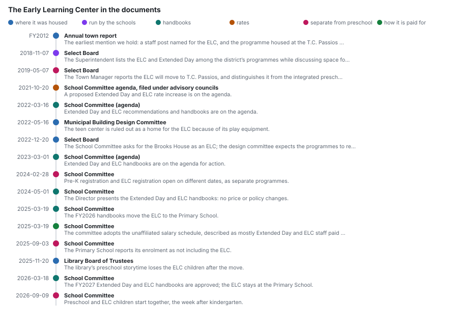
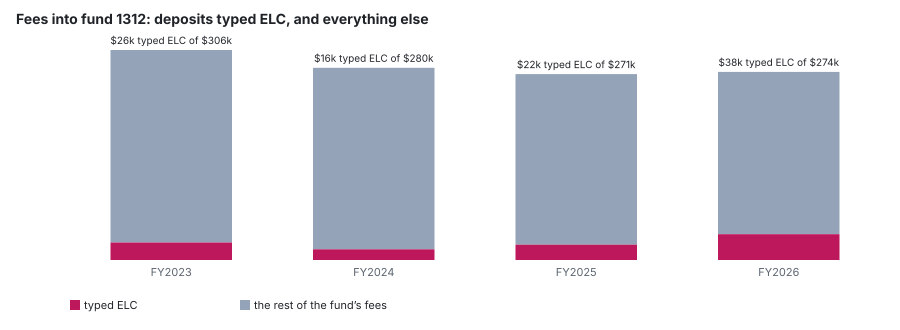
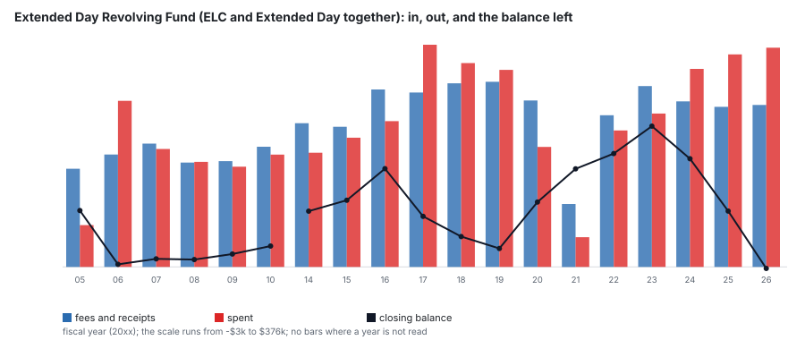

# The Early Learning Center

A school district programme, run beside Extended Day and paid for from the same fees, and not the same thing as the preschool.

## What the documents establish

- **The schools run it.** The Extended Day and ELC handbooks come to the School Committee each spring (2022, 2023, 2024, 2025, 2026), and the staff directory lists the post that runs it as *Director of Community School Programs (Extended Day, ELC, and Life-Long Learning Programs)*.
- **It is not the preschool.** The Town Manager called it *“the Early Learning Program (not the integrated preschool program)”* in 2019; it registers on its own dates, apart from Pre-K; the Primary School counts its enrolment *“not including the ELC”*; and the payment portal sells *Extended Day & ELC* and a *Primary Preschool Program* as two items.
- **Its money is a school revolving fund.** Families pay through the district’s RevTrak portal, and the deposits post to fund 1312, the [Extended Day Revolving Fund](/school-funds/extended-day-revolving-fund). The fund pays the staff of both programmes, and their health insurance, from those fees.
- **The journal alone could not have shown this**: it holds only school accounts, so anything found in it is school money by construction. The minutes are what establish it.

## Timeline

Every entry quotes its document, and the build fails if the quotation is not there.

| when | body | what the document records | in its words |
|---|---|---|---|
| FY2012 | Annual town report | The earliest mention we hold: a staff post named for the ELC, and the programme housed at the T.C. Passios building. | *“The district's Extended Day, Early Learning, and School Linked Services programs operate in the building”* ([document](https://www.lunenburgma.gov/DocumentCenter/View/4118), [our copy](/docs/town-annual-reports/docs/4118-fy-2012-annual-town-report.pdf)) |
| 2018-11-07 | Select Board | The Superintendent lists the ELC and Extended Day among the district’s programmes while discussing space for Pre-K classrooms. | *“We have the Early Learning Center and Extended Day Program.”* ([document](https://www.lunenburgma.gov/AgendaCenter/ViewFile/Minutes/_11072018-5125), [our copy](/docs/meetings/select-board/2018-11-07-minutes-5125.pdf)) |
| 2019-05-07 | Select Board | The Town Manager reports the ELC will move to T.C. Passios, and distinguishes it from the integrated preschool. | *“the Early Learning Program (not the integrated preschool program) relocating to the TC Passios beginning next school year”* ([document](https://www.lunenburgma.gov/AgendaCenter/ViewFile/Minutes/_05072019-5159), [our copy](/docs/meetings/select-board/2019-05-07-minutes-5159.pdf)) |
| 2021-10-20 | School Committee agenda, filed under advisory councils | A proposed Extended Day and ELC rate increase is on the agenda. | *“Extended Day/ELC Proposed Rate Increase”* ([document](https://www.lunenburgma.gov/AgendaCenter/ViewFile/Agenda/_10202021-4386), [our copy](/docs/meetings/school-advisory-councils-committees/2021-10-20-agenda-4386.pdf)) |
| 2022-03-16 | School Committee (agenda) | Extended Day and ELC recommendations and handbooks are on the agenda. | *“Extended Day & ELC Recommendations and Handbooks”* ([document](https://www.lunenburgma.gov/AgendaCenter/ViewFile/Agenda/_03162022-4452), [our copy](/docs/meetings/school-committee/2022-03-16-agenda-4452.pdf)) |
| 2022-05-16 | Municipal Building Design Committee | The teen center is ruled out as a home for the ELC because of its play equipment. | *“The teen center could not accommodate with the early learning center”* ([document](https://www.lunenburgma.gov/AgendaCenter/ViewFile/Minutes/_05162022-3097), [our copy](/docs/meetings/lunenburg-municipal-building-design-committee/2022-05-16-minutes-3097.pdf)) |
| 2022-12-20 | Select Board | The School Committee asks for the Brooks House as an ELC; the design committee expects the programmes to return to school buildings. | *“they would like to use the Brooks House as an Early Learning Center”* ([document](https://www.lunenburgma.gov/AgendaCenter/ViewFile/Minutes/_12202022-5299), [our copy](/docs/meetings/select-board/2022-12-20-minutes-5299.pdf)) |
| 2023-03-01 | School Committee (agenda) | Extended Day and ELC handbooks are on the agenda for action. | *“Extended Day & ELC Handbooks”* ([document](https://www.lunenburgma.gov/AgendaCenter/ViewFile/Agenda/_03012023-215), [our copy](/docs/meetings/school-committee/2023-03-01-agenda-215.pdf)) |
| 2024-02-28 | School Committee | Pre-K registration and ELC registration open on different dates, as separate programmes. | *“the Early Learning Center registration will open on Monday May 20th”* ([document](https://www.lunenburgma.gov/AgendaCenter/ViewFile/Minutes/_02282024-6439), [our copy](/docs/meetings/school-committee/2024-02-28-minutes-6439.pdf)) |
| 2024-05-01 | School Committee | The Director presents the Extended Day and ELC handbooks: no price or policy changes. | *“There are no price or policy changes.”* ([document](https://www.lunenburgma.gov/AgendaCenter/ViewFile/Minutes/_05012024-6554), [our copy](/docs/meetings/school-committee/2024-05-01-minutes-6554.pdf)) |
| 2025-03-19 | School Committee | The FY2026 handbooks move the ELC to the Primary School. | *“Early Learning Center will be moved to the Primary School.”* ([document](https://www.lunenburgma.gov/AgendaCenter/ViewFile/Minutes/_03192025-7111), [our copy](/docs/meetings/school-committee/2025-03-19-minutes-7111.pdf)) |
| 2025-03-19 | School Committee | The committee adopts the unaffiliated salary schedule, described as mostly Extended Day and ELC staff paid from the revolving fund. | *“This mostly is the staff of the extended day, ELC staff and is primarily paid out of the revolving account”* ([document](https://www.lunenburgma.gov/AgendaCenter/ViewFile/Minutes/_03192025-7111), [our copy](/docs/meetings/school-committee/2025-03-19-minutes-7111.pdf)) |
| 2025-09-03 | School Committee | The Primary School reports its enrolment as not including the ELC. | *“students at the Primary School, not including the ELC”* ([document](https://www.lunenburgma.gov/AgendaCenter/ViewFile/Minutes/_09032025-7385), [our copy](/docs/meetings/school-committee/2025-09-03-minutes-7385.pdf)) |
| 2025-11-20 | Library Board of Trustees | The library’s preschool storytime loses the ELC children after the move. | *“losing the early learning center kids due to their relocation”* ([document](https://www.lunenburgma.gov/AgendaCenter/ViewFile/Minutes/_11202025-7518), [our copy](/docs/meetings/library-board-of-trustees/2025-11-20-minutes-7518.pdf)) |
| 2026-03-18 | School Committee | The FY2027 Extended Day and ELC handbooks are approved; the ELC stays at the Primary School. | *“FY 27 Extended Day and ELC Handbooks”* ([document](https://www.lunenburgma.gov/AgendaCenter/ViewFile/Minutes/_03182026-7719), [our copy](/docs/meetings/school-committee/2026-03-18-minutes-7719.pdf)) |
| 2026-09-09 | School Committee | Preschool and ELC children start together, the week after kindergarten. | *“preschool and Early Learning Center students began the following week”* ([document](https://www.lunenburgma.gov/AgendaCenter/ViewFile/Minutes/_09092026-8002), [our copy](/docs/meetings/school-committee/2026-09-09-minutes-8002.pdf)) |

Two School Committee transfers from the Extended Day account to the town for rent of T.C. Passios were voted on 2019-10-02 and 2020-02-26; they are heard in the meeting recordings only, and the amounts are a caption model’s, not figures (`board-transfers.csv`).

## The money

Every posting to the fund, by year and by account, is on [the fund’s own page](/school-funds/extended-day-revolving-fund).

### Fees typed “ELC”, against all fees into the fund

| fiscal year | fees typed ELC | deposit lines | all fees into fund 1312 | deposit lines |
|---|---:|---:|---:|---:|
| FY2023 | $25,574 | 34 | $306,343 | 131 |
| FY2024 | $15,605 | 27 | $280,400 | 121 |
| FY2025 | $22,353 | 27 | $271,204 | 113 |
| FY2026 | $37,607 | 27 | $274,325 | 105 |

The label is typed by whoever posts the deposit and nothing requires it, so the ELC column is a floor. The rest of the fund’s fees are Extended Day, summer and unlabelled ELC payments in proportions the ledger cannot tell apart.

### What the fund spent, by account

| account | FY2023 | FY2024 | FY2025 | FY2026 |
|---|---:|---:|---:|---:|
| general supplies | $2,257 | $1,372 | $3,859 | $1,980 |
| health insurance | $47,095 | $50,015 | $52,901 | $55,689 |
| purchase of service | $24,398 | $51,210 | $23,785 | $255 |
| salaries revolving funds | $186,113 | $232,940 | $279,448 | $313,537 |

One payroll account carries both programmes, so none of this can be attributed to the ELC.

### The fund, year by year

| fiscal year | opening | fees and receipts | spent | closing | from |
|---|---:|---:|---:|---:|---|
| FY2005 | $0 | $166,292 | $70,763 | $95,528 | annual town report, 2005, p64 |
| FY2006 | $95,528 | $190,363 | $281,423 | $4,468 | annual town report, 2006, p59 |
| FY2007 | $4,468 | $208,978 | $199,807 | $13,639 | annual town report, 2007, p68 |
| FY2008 | $13,639 | $176,746 | $178,014 | $12,371 | annual town report, 2008, p71 |
| FY2009 | $12,371 | $179,252 | $169,744 | $21,878 | annual town report, 2009, p56 |
| FY2010 | $21,878 | $203,643 | $190,236 | $35,285 | annual town report, 2010, p65 |
| FY2014 | $44,340 | $243,502 | $193,432 | $94,410 | annual town report, FY2014, p30 |
| FY2015 | $94,410 | $237,399 | $218,924 | $112,884 | annual town report, FY2015, p30 |
| FY2016 | $112,884 | $300,591 | $246,944 | $166,531 | annual town report, FY2016-addendum, p3 |
| FY2017 | $166,531 | $295,495 | $376,424 | $85,602 | annual town report, FY2017, p30 |
| FY2018 | $85,602 | $311,152 | $345,369 | $51,385 | annual town report, FY2018, p36 |
| FY2019 | $51,385 | $313,668 | $333,854 | $31,199 | annual town report, FY2019, p38 |
| FY2020 | $31,199 | $281,945 | $203,287 | $109,857 | annual town report, FY2020, p32 |
| FY2021 | $109,857 | $106,655 | $50,326 | $166,186 | annual town report, FY2021, p33 |
| FY2022 | $166,186 | $256,959 | $231,132 | $192,013 | annual town report, FY2022, p34 |
| FY2023 | $192,013 | $306,343 | $259,863 | $238,493 | annual town report, FY2023, p35 |
| FY2024 | $238,493 | $280,400 | $335,537 | $183,356 | school journal (school-fund-flows.csv) |
| FY2025 | $183,356 | $271,204 | $359,993 | $94,567 | school journal (school-fund-flows.csv) |
| FY2026 | $94,567 | $274,325 | $371,461 | -$2,569 | school journal (school-fund-flows.csv) |

Each row foots (opening + receipts - spent = closing) and each year opens on the last one’s close where the years are consecutive. FY2023 is in both the annual report and the journal and they agree to the cent. The years FY2011 to FY2013 are not in our reading of the annual reports’ fund tables. This is the whole fund, Extended Day included.

### Not counted here

18 journal lines are labelled preschool or PreK. The documents treat the preschool as a separate programme, so they are left out, and so is the federal early childhood special education grant (#262), whose lines never name the ELC.

### Every journal line typed “ELC”, by where it posts

| fund | account | lines | net amount |
|---|---|---:|---:|
| 1312 extended day revolving fund | fees | 115 | -$101,140 |
| 1312 extended day revolving fund | general supplies | 1 | $45 |

Revenue is negative in the ledger: a fee is a credit.

## People

Who the annual town reports list under Extended Day, the ELC and the programmes beside them, as the town headed them each year.

| year | group, as printed | names (role, where printed) | page |
|---|---|---|---|
| FY2004 | THOMAS C. PASSIOS SCHOOL | Sandy Flanagan (Day Care) | p46 |
| FY2005 | EXTENDED DAY | Sandy Flanagan; Colleen Gardner; Annette Queen; Tammy Priest | p47 |
| FY2006 | EXTENDED DAY | Sandy Flanagan; Colleen Gardner; Annette Queen; Tammy Priest | p42 |
| FY2007 | EXTENDED DAY | Tammy Perry; Annette Queen; Tammy Priest; Nora Pearson | p49 |
| FY2008 | EXTENDED DAY | Tammy Perry (Coordinator); Annette Queen; Tammy Priest; Sandra Sheehy | p45 |
| FY2009 | EXTENDED DAY | Tammy Perry (Coordinator); Annette Queen; Tammy Priest | p32 |
| FY2010 | EXTENDED DAY PROGRAM | Tammy Perry (Coordinator); Annette Queen; Tammy Priest | p39 |
| FY2011 | EXTENDED DAY PROGRAM | Tammy Perry (Coordinator); Annette Queen (Coordinator) | p38 |
| FY2012 | Extended Day/School Linked Services | Tammy Perry (Extended Day & Early Learning Center); Patty McCarthy-Guillette (School Linked Services) | p31 |
| FY2013 | *none printed* | the Primary School roster lists 69 names and no such group | |
| FY2014 | *none printed* | the Primary School roster lists 69 names and no such group | |
| FY2015 | *none printed* | the Primary School roster lists 82 names and no such group | |
| FY2016 | *none printed* | the Primary School roster lists 62 names and no such group | |
| FY2017 | Extended Day | Tammy Perry; Annette Queen; Christin Leger; Natalie Marabello; Mary Marino; Terri Green | p109 |
| FY2018 | Extended Day | Tammy Perry; Annette Queen | p122 |
| FY2019 | *none printed* | the Primary School roster lists 72 names and no such group | |
| FY2020 | *none printed* | the Primary School roster lists 69 names and no such group | |
| FY2021 | *none printed* | the Primary School roster lists 55 names and no such group | |
| FY2022 | *none printed* | the Primary School roster lists 71 names and no such group | |
| FY2023 | *none printed* | the Primary School roster lists 84 names and no such group | |
| FY2024 | *none printed* | the Primary School roster lists 73 names and no such group | |
| FY2025 | Ext Day/ELC | Patty McCarthy-Guillette (Director); Annette Queen; Natalie Marabello | p101 |
| FY2025 | CFCE Grant Program | Meaghan Lamachia | p101 |

In 10 of these 22 years the Primary School roster was printed and read but carries no Extended Day or ELC group. To check that the group was not simply filed under another name, each person listed in it in two or more years was searched for by full name, in either order, in the full text of those reports:

| name | years in the group | named anywhere in the years with no group |
|---|---:|---|
| Annette Queen | 10 | FY2014, FY2015, FY2016, FY2019, FY2021 |
| Tammy Perry | 8 | FY2014, FY2015, FY2016, FY2021 |
| Tammy Priest | 6 | none |
| Sandy Flanagan | 3 | FY2015 |
| Colleen Gardner | 2 | none |
| Natalie Marabello | 2 | FY2014, FY2015, FY2016, FY2019, FY2021 |
| Patty McCarthy-Guillette | 2 | none |

Where a name does appear in a year with no group, it is under another heading, such as a classroom or the town’s wage list, which names no programme; a name found does not say what the person did that year. A roster lists names with no FTE and no funding source, so it is not a staffing level.

## What we cannot say

- How many children attend the ELC, in any year. No document we hold counts them; the Primary School reports its enrolment without them.
- What the ELC charges. The payment portal sells it beside Extended Day and publishes no rates, and no fee schedule is in a budget book or a warrant.
- What the ELC costs. It shares fund 1312, and its payroll account, with Extended Day, so its spending cannot be separated.
- Whether the general fund carries any ELC cost, such as space, utilities or administration, that is not booked to the fund.
- Its age range, hours, or whether it is licensed as child care.

Registered in `sources/data/money-gaps.csv`, each with the document that would settle it:

- **How much of the Extended Day Revolving Fund is the Early Learning Center, in fees, in staff and in children?** The ELC and Extended Day share fund 1312 and one payroll account. A deposit is labelled ELC only when whoever posts it types the word, so the ledger gives a floor for ELC fees and nothing at all for ELC spending, and no document we hold counts the children enrolled. See /analysis/early-learning-center. — closes: the district’s RevTrak payment report by item (Extended Day & ELC versus the other items) with enrolment by programme, or a programme-level budget for fund 1312.
- **What the six fees the district’s payment portal sells actually cost** The district’s RevTrak portal offers an Afterschool Activity Fee, a Chromebook Repair Fee, Extended Day & ELC, Field Trips, an LHS Parking Permit and a Primary Preschool Program. The portal renders in JavaScript and serves no amounts to a plain fetch, and no fee schedule for any of them appears in a budget book, a warrant or a set of minutes in this archive. So the existence of each fee is established and the amount of every one of them is not, and any total of what a Lunenburg family pays the schools in a year is a floor with six named items sitting above it. — closes: the district’s published schedule of student fees for the current year, listing every fee the portal charges with its amount.
- **What a fee-funded school programme costs that is not booked to its own fund** A revolving fund that takes in more than it spends covers the costs BOOKED TO IT, and nothing more (rule 11). The ledger can test whether the general fund also carries a programme's costs only where both book to the same programme-specific DESE function code, and among the schools' fee and lunch funds that is true of athletics alone (function 3510, where the general fund booked most of the four years' athletics spending). Extended day, after-school activities, facilities rental and adult education book their spending to function codes that name no programme -- 2000, 4000, 5200 -- so whether the general fund pays any of their custodians, utilities, administration or benefits cannot be shown either way. 'Pays its own way' therefore cannot be stated for any of them beyond their own books. Measured in /analysis/spending-what-comes-in. — closes: the district's indirect-cost allocation for each revolving programme, or a cost study listing the general fund accounts that carry part of each programme's cost.

## Where it comes from

| what | where |
|---|---|
| The Extended Day Revolving Fund’s own page: every posting, by year | /school-funds/extended-day-revolving-fund |
| Every school journal line, FY2023 to FY2026 | /docs/data/munis-school-journal.csv |
| The fund’s money in, out and balance, by year, from the journal | /docs/data/school-fund-flows.csv |
| The fund’s balance from the annual town reports | /docs/data/special-revenue-funds.csv |
| Staff rosters from the annual reports | /docs/data/staff-roster-entries.csv |
| Meeting minutes and agendas (each cited in the timeline) | /minutes/find/ |

35 documents in the archive name the ELC: `meetings/text/library-board-of-trustees/2024-03-21-minutes-6479.txt`, `meetings/text/library-board-of-trustees/2024-04-18-minutes-6525.txt`, `meetings/text/library-board-of-trustees/2024-05-16-minutes-6572.txt`, `meetings/text/library-board-of-trustees/2025-11-20-minutes-7518.txt`, `meetings/text/lunenburg-municipal-building-design-committee/2022-05-16-minutes-3097.txt`, `meetings/text/school-advisory-councils-committees/2021-10-20-agenda-4386.txt`, `meetings/text/school-committee/2022-03-16-agenda-4452.txt`, `meetings/text/school-committee/2022-03-16-agenda-4453.txt`, `meetings/text/school-committee/2022-03-16-agenda-4461.txt`, `meetings/text/school-committee/2023-03-01-agenda-215.txt`, `meetings/text/school-committee/2023-05-24-agenda-223.txt`, `meetings/text/school-committee/2024-01-24-minutes-6375.txt`, `meetings/text/school-committee/2024-02-28-minutes-6439.txt`, `meetings/text/school-committee/2024-04-03-minutes-6504.txt`, `meetings/text/school-committee/2024-04-10-minutes-6521.txt`, `meetings/text/school-committee/2024-05-01-agenda-6554.txt`, `meetings/text/school-committee/2024-05-01-minutes-6554.txt`, `meetings/text/school-committee/2024-05-22-minutes-6581.txt`, `meetings/text/school-committee/2025-03-19-agenda-7111.txt`, `meetings/text/school-committee/2025-03-19-agenda-7113.txt`, `meetings/text/school-committee/2025-03-19-minutes-7111.txt`, `meetings/text/school-committee/2025-04-16-minutes-7171.txt`, `meetings/text/school-committee/2025-09-03-minutes-7385.txt`, `meetings/text/school-committee/2026-03-18-agenda-7719.txt`, `meetings/text/school-committee/2026-03-18-minutes-7719.txt`, `meetings/text/school-committee/2026-09-09-minutes-8002.txt`, `meetings/text/select-board/2017-10-17-minutes-5047.txt`, `meetings/text/select-board/2017-11-09-minutes-5051.txt`, `meetings/text/select-board/2018-11-07-minutes-5125.txt`, `meetings/text/select-board/2019-05-07-minutes-5159.txt`, `meetings/text/select-board/2022-12-20-minutes-5299.txt`, `town-annual-reports/text/4118-fy-2012-annual-town-report.txt`, `town-annual-reports/text/4124-fy-2017-annual-town-report.txt`, `town-annual-reports/text/4126-fy-2019-annual-town-report.txt`, `town-annual-reports/text/4130-fy-2025-annual-town-report.txt`.

