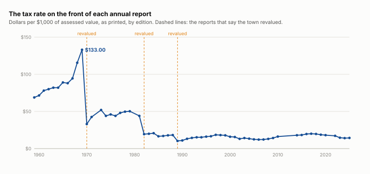
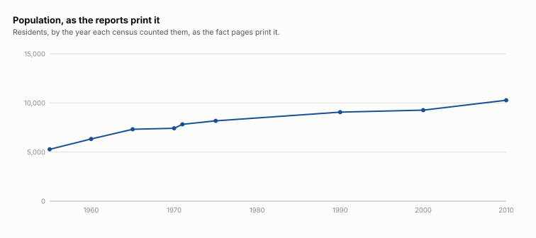
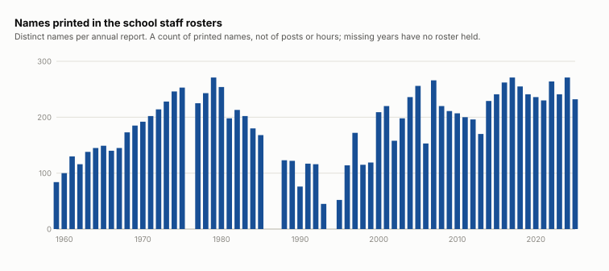

# Lunenburg Historical Report

Sixty-seven annual town reports, 1959 to FY2025, read into this archive. Every figure below comes out of them, with the edition and page.

## The short version

- **The tax rate is not the tax.** $133.00 per $1,000 in the 1969 report, $14.36 in FY2025, and each big fall sits beside a report recording a revaluation.
- **The longest run on the school rosters** is Richard A. Stachowicz, 1963 to 2001.
- **A town manager took 33 years**, from the first study recommending one (1966) to the charter that created the post (1999).
- **Population** went from 5,282 (1955) to 10,280 (2010).

## Across all the years

### The tax rate, and the three revaluations

The rate each edition prints on its fact page, per $1,000 of assessed value. Until the 1990 edition the page prints a bare rate; from then it names the fiscal year it applies to, usually the next one. The falls:

| from | to | fall |
|---|---|---:|
| [1969 report, p. 3](/docs/town-annual-reports/docs/4512-1969-annual-town-report.pdf#page=3), $133.00 | [1970 report, p. 3](/docs/town-annual-reports/docs/4492-1970-annual-town-report.pdf#page=3), $33.00 | 75% |
| [1981 report, p. 3](/docs/town-annual-reports/docs/4503-1981-annual-town-report.pdf#page=3), $44.00 | [1982 report, p. 3](/docs/town-annual-reports/docs/4504-1982-annual-town-report.pdf#page=3), $19.40 | 56% |
| [1988 report, p. 5](/docs/town-annual-reports/docs/4487-1988-annual-town-report.pdf#page=5), $18.23 | [1989 report, p. 3](/docs/town-annual-reports/docs/4488-1989-annual-town-report.pdf#page=3), $10.27 | 44% |

And what the reports say about those years, in their own words:

- [1970 report, p. 8](/docs/town-annual-reports/docs/4492-1970-annual-town-report.pdf#page=8): “In 1970 Lunenburg went to full and fair valuation.”
- [1982 report, p. 11](/docs/town-annual-reports/docs/4504-1982-annual-town-report.pdf#page=11): “STATE MANDATED REVALUATION AND HOW LUNENBURG COMPLIED WITH THE LAW.”
- [1989 report, p. 7](/docs/town-annual-reports/docs/4488-1989-annual-town-report.pdf#page=7): “a full 1990 revaluation with subsequent certification by the Department of Revenue.”

The falls and the revaluations line up; what the reports state is the revaluation, and the rate falling with it is our reading of the coincidence. A rate set on property valued at a fraction of its worth is not comparable with one set at full value, so the line above is three or four series, not one.

Not plotted: 1972, 1980, 2011, 2012, 2013, 2021. Their fact pages did not yield a rate to this reader, which is a statement about our extraction, not about the reports.

### How many people

| year counted | population | what kind | first printed in |
|---:|---:|---|---|
| 1955 | 5,282 | kind not printed | [1959 report, p. 4](/docs/town-annual-reports/docs/4550-1959-annual-town-report.pdf#page=4) |
| 1960 | 6,334 | kind not printed | [1960 report, p. 6](/docs/town-annual-reports/docs/4551-1960-annual-town-report.pdf#page=6) |
| 1965 | 7,321 | kind not printed | [1965 report, p. 4](/docs/town-annual-reports/docs/4508-1965-annual-town-report.pdf#page=4) |
| 1970 | 7,396 | preliminary | [1970 report, p. 3](/docs/town-annual-reports/docs/4492-1970-annual-town-report.pdf#page=3) |
| 1970 | 7,419 | U.S. Census | [1971 report, p. 2](/docs/town-annual-reports/docs/4493-1971-annual-town-report.pdf#page=2) |
| 1971 | 7,825 | state census | [1973 report, p. 3](/docs/town-annual-reports/docs/4495-1973-annual-town-report.pdf#page=3) |
| 1975 | 8,175 | state census | [1975 report, p. 3](/docs/town-annual-reports/docs/4497-1975-annual-town-report.pdf#page=3) |
| 1980 | 8,375 | preliminary | [1981 report, p. 3](/docs/town-annual-reports/docs/4503-1981-annual-town-report.pdf#page=3) |
| 1980 | 8,375 | U.S. Census | [1983 report, p. 3](/docs/town-annual-reports/docs/4483-1983-annual-town-report.pdf#page=3) |
| 1980 | 8,710 | U.S. Census | [1989 report, p. 3](/docs/town-annual-reports/docs/4488-1989-annual-town-report.pdf#page=3) |
| 1986 | 8,508 | town census | [1986 report, p. 3](/docs/town-annual-reports/docs/4549-1986-annual-town-report.pdf#page=3) |
| 1987 | 8,512 | town census | [1987 report, p. 3](/docs/town-annual-reports/docs/4486-1987-annual-town-report.pdf#page=3) |
| 1988 | 8,465 | town census | [1988 report, p. 5](/docs/town-annual-reports/docs/4487-1988-annual-town-report.pdf#page=5) |
| 1990 | 9,062 | U.S. Census | [1990 report, p. 3](/docs/town-annual-reports/docs/4489-1990-annual-town-report.pdf#page=3) |
| 1990 | 8,685 | town census | [1990 report, p. 3](/docs/town-annual-reports/docs/4489-1990-annual-town-report.pdf#page=3) |
| 1991 | 8,835 | town census | [1991 report, p. 3](/docs/town-annual-reports/docs/4490-1991-annual-town-report.pdf#page=3) |
| 1992 | 8,771 | town census | [1992 report, p. 3](/docs/town-annual-reports/docs/4491-1992-annual-town-report.pdf#page=3) |
| 1993 | 8,775 | town census | [1993 report, p. 3](/docs/town-annual-reports/docs/4519-1993-annual-town-report.pdf#page=3) |
| 1994 | 8,775 | town census | [1994 report, p. 4](/docs/town-annual-reports/docs/4520-1994-annual-town-report.pdf#page=4) |
| 1995 | 8,943 | town census | [1995 report, p. 8](/docs/town-annual-reports/docs/4521-1995-annual-town-report.pdf#page=8) |
| 2000 | 9,365 | town census | [2000 report, p. 5](/docs/town-annual-reports/docs/4526-2000-annual-town-report.pdf#page=5) |
| 2000 | 9,264 | U.S. Census | [2001 report, p. 5](/docs/town-annual-reports/docs/4527-2001-annual-town-report.pdf#page=5) |
| 2001 | 9,365 | town census | [2001 report, p. 5](/docs/town-annual-reports/docs/4527-2001-annual-town-report.pdf#page=5) |
| 2002 | 9,405 | town census | [2002 report, p. 4](/docs/town-annual-reports/docs/4528-2002-annual-town-report.pdf#page=4) |
| 2003 | 9,650 | town census | [2003 report, p. 4](/docs/town-annual-reports/docs/4529-2003-annual-town-report.pdf#page=4) |
| 2004 | 9,518 | town census | [2004 report, p. 5](/docs/town-annual-reports/docs/4530-2004-annual-town-report.pdf#page=5) |
| 2004 | 9,554 | town census | [2005 report, p. 4](/docs/town-annual-reports/docs/4513-2005-annual-town-report.pdf#page=4) |
| 2005 | 9,706 | town census | [2006 report, p. 4](/docs/town-annual-reports/docs/4514-2006-annual-town-report.pdf#page=4) |
| 2008 | 9,737 | town census | [2008 report, p. 5](/docs/town-annual-reports/docs/4516-2008-annual-town-report.pdf#page=5) |
| 2009 | 9,720 | town census | [2009 report, p. 6](/docs/town-annual-reports/docs/4517-2009-annual-town-report.pdf#page=6) |
| 2009 | 9,776 | town census | [2010 report, p. 5](/docs/town-annual-reports/docs/4518-2010-annual-town-report.pdf#page=5) |
| 2010 | 10,280 | U.S. Census | [2010 report, p. 5](/docs/town-annual-reports/docs/4518-2010-annual-town-report.pdf#page=5) |

Where two editions print different figures for the same year, both are kept: 1980, U.S. Census (8,375 in [1983 report, p. 3](/docs/town-annual-reports/docs/4483-1983-annual-town-report.pdf#page=3), 8,710 in [1989 report, p. 3](/docs/town-annual-reports/docs/4488-1989-annual-town-report.pdf#page=3)); 2004, town census (9,518 in [2004 report, p. 5](/docs/town-annual-reports/docs/4530-2004-annual-town-report.pdf#page=5), 9,554 in [2005 report, p. 4](/docs/town-annual-reports/docs/4513-2005-annual-town-report.pdf#page=4)); 2009, town census (9,720 in [2009 report, p. 6](/docs/town-annual-reports/docs/4517-2009-annual-town-report.pdf#page=6), 9,776 in [2010 report, p. 5](/docs/town-annual-reports/docs/4518-2010-annual-town-report.pdf#page=5)). The chart leaves those out rather than choose, and draws only the census counts: the town’s own yearly census is a different count and is in the table only.

The Treasurer printed a then-and-now table twice, in [1961 report, p. 15](/docs/town-annual-reports/docs/4548-1961-annual-town-report.pdf#page=15) and [1991 report, p. 30](/docs/town-annual-reports/docs/4490-1991-annual-town-report.pdf#page=30), and the second reprints the first’s figures as its THEN column, so the two chain: population 3,906 (1951), 6,334 (1961), 8,987 (1991); persons on the town payroll 146, 321, 411.

Town roads on the fact page: 75.74 miles in the 1959 report, 100 in the 2010 report.

### Names on the school rosters

The rosters print 84 names in 1959 and 232 in 2025. A count of printed names, not a staffing level: no roster states hours or FTE, some years print only part of the district, and 4 editions have no roster we hold (1976, 1986, 1987, 1994).

## Firsts and longest

### The road to a town manager

| report | what happened | in the report’s words |
|---|---|---|
| [1966 report, p. 14](/docs/town-annual-reports/docs/4509-1966-annual-town-report.pdf#page=14) | A study committee names a town manager as its preferred form. | “Of the alternative forms of government considered, this Committee believes that the "Town Manager with Strong Charter" form” — and, first: “There is no immediate, pressing need for a major reorganization of the Lunenburg Town Government” |
| [1983 report, p. 30](/docs/town-annual-reports/docs/4483-1983-annual-town-report.pdf#page=30) | A second study committee is appointed for the same question. | “investigate the establishment of a Selectmen-Town Manager form of government” |
| [1999 report, p. 10](/docs/town-annual-reports/docs/4525-1999-annual-town-report.pdf#page=10) | A Home Rule Charter creates the post, under another name: CAFO. | “Adoption of the new charter resulted in an increased membership in the Board of Selectmen, the Board of Health and the creation of a new position, Chief Administrative Financial Officer (CAFO)” |
| [2000 report, p. 12](/docs/town-annual-reports/docs/4526-2000-annual-town-report.pdf#page=12) | The first CAFO is hired. | “resulted in the hiring of William J. Gustus to fill the position” |
| [2005 report, p. 27](/docs/town-annual-reports/docs/4513-2005-annual-town-report.pdf#page=27) | A charter review proposes renaming the post. | “The CAFO will be renamed to Town Manager.” |
| [2008 report, p. 28](/docs/town-annual-reports/docs/4516-2008-annual-town-report.pdf#page=28) | The rename is still waiting on the state at the end of the year. | “these changes to the Charter have not yet received the necessary state approvals” |
| [2009 report, p. 12](/docs/town-annual-reports/docs/4517-2009-annual-town-report.pdf#page=12) | The report prints its first section headed TOWN MANAGER. | “TOWN MANAGER One of the most significant events” |

The charter was Question 2 on the ballot headed “ANNUAL TOWN ELECTION - SATURDAY MAY 1, 1999” ([1999 report, p. 80](/docs/town-annual-reports/docs/4525-1999-annual-town-report.pdf#page=80)): YES 422, NO 150, precinct by precinct 162, 117, 122, 21 against 57, 43, 44, 6, and the precincts sum to the printed totals. The fact page’s *Type of government* line reads “Town Meeting” until the [2005 report, p. 4](/docs/town-annual-reports/docs/4513-2005-annual-town-report.pdf#page=4), which first prints “Open Town Meeting”.

### The longest runs on the school rosters

A run is the years between the first and last roster a name is printed in, broken when the name is missing from more than 2 consecutive rosters we hold. That threshold is ours.

| name | first | last | span | printed in | first entry | last entry |
|---|---|---|---:|---:|---|---|
| Richard A. Stachowicz | 1963 | 2001 | 38 years | 34 of 35 | [1963 report, p. 111](/docs/town-annual-reports/docs/4506-1963-annual-town-report.pdf#page=111), “Elementary, Jr. and Sr. High Boys Phys. Ed. Instructor” | [2001 report, p. 40](/docs/town-annual-reports/docs/4527-2001-annual-town-report.pdf#page=40), “PHYSICAL EDUCATION” |
| Peter B. Lincoln | 1964 | 2001 | 37 years | 33 of 34 | [1964 report, p. 112](/docs/town-annual-reports/docs/4507-1964-annual-town-report.pdf#page=112), “Sr. High English” | [2001 report, p. 40](/docs/town-annual-reports/docs/4527-2001-annual-town-report.pdf#page=40), “ENGLISH” |
| James Besarkarski | 1968 | 2005 | 37 years | 32 of 34 | [1968 report, p. 121](/docs/town-annual-reports/docs/4511-1968-annual-town-report.pdf#page=121), “Gr. 8 (Homeroom Gr. 8 (#250))” | [2005 report, p. 41](/docs/town-annual-reports/docs/4513-2005-annual-town-report.pdf#page=41), “SCIENCE” |
| Jane Whitney | 1966 | 2003 | 37 years | 32 of 34 | [1966 report, p. 103](/docs/town-annual-reports/docs/4509-1966-annual-town-report.pdf#page=103), “Jr. High Social Studies; Homeroom Gr. 8, Rm. #241.” | [2003 report, p. 41](/docs/town-annual-reports/docs/4529-2003-annual-town-report.pdf#page=41), “Social Studies” |
| Mary Lynn Conrad | 1969 | 2005 | 36 years | 29 of 33 | [1969 report, p. 114](/docs/town-annual-reports/docs/4512-1969-annual-town-report.pdf#page=114), “Grade 3D” | [2005 report, p. 45](/docs/town-annual-reports/docs/4513-2005-annual-town-report.pdf#page=45), “3D” |
| Louise A. Morin | 1967 | 2002 | 35 years | 28 of 32 | [1967 report, p. 118](/docs/town-annual-reports/docs/4510-1967-annual-town-report.pdf#page=118), “Grade 4D” | [2002 report, p. 43](/docs/town-annual-reports/docs/4528-2002-annual-town-report.pdf#page=43), “Grade 4” |

**One name, two careers.** Matched on name alone, Genevieve Nass would top that table at 42 years. The rosters print the name from 1961 ([1961 report, p. 119](/docs/town-annual-reports/docs/4548-1961-annual-town-report.pdf#page=119), “Substitute (School Cafeteria Substitutes)”) to 1981 ([1981 report, p. 78](/docs/town-annual-reports/docs/4503-1981-annual-town-report.pdf#page=78), “Cook/Manager”); it is then absent from 14 rosters in a row, and returns in 1999 ([1999 report, p. 43](/docs/town-annual-reports/docs/4525-1999-annual-town-report.pdf#page=43)) under “Phys. Ed.”, last printed in 2003. Whether that is one person this archive cannot say, which is why a run breaks on a long absence.

**The first aide.** Dorothy Hillman, [1970 report, p. 112](/docs/town-annual-reports/docs/4492-1970-annual-town-report.pdf#page=112): “Teacher Aide for Perceptually Handicapped Program”. The 2025 roster prints 52 entries classified as paraprofessional.

## Then and now

**1910 against 1960**, a table the Assessors printed in [1960 report, p. 9](/docs/town-annual-reports/docs/4551-1960-annual-town-report.pdf#page=9): tax rate $15.00 and $71.50 per $1,000; dwelling houses 430 and 1,734; people assessed a poll tax 381 and 1,844. 1960 also counts 452 camps -- seasonal houses, not lived in year-round -- and 46 trailers, which 1910 does not. Real estate was valued at $1,074,296 and $9,272,790; the motor vehicle excise brought in $111,623 in 1960 and is printed “None” for 1910. The same page: “"How much will my valuation be increased if I landscape my lot, or paint my house?" The answer is that no increase is ever made for these reasons.”

**Building permits**: 369 in 1961 and 201 in 1991, by the same Treasurer’s tables.

**School lunch, 1959**: 126,016 Type A lunches at 25 cents each over the school year ([1959 report, p. 111](/docs/town-annual-reports/docs/4550-1959-annual-town-report.pdf#page=111)). The printed total equals the sum of the ten months, 126,016.

**The levy**: $251,843 raised by taxation in 1950 at a rate of $52.00 ([1968 report, p. 11](/docs/town-annual-reports/docs/4511-1968-annual-town-report.pdf#page=11)), and $17,427,297 levied in FY2010 at $14.20 ([2010 report, p. 13](/docs/town-annual-reports/docs/4518-2010-annual-town-report.pdf#page=13)). Nominal dollars, and two different assessment bases.

## Did you know

**The tie of 1959.** The race for Selectman at the March election was printed as 853 to 853, “Original Count Before Recount” ([1959 report, p. 58](/docs/town-annual-reports/docs/4550-1959-annual-town-report.pdf#page=58)). A special election on May 16 settled it: Howard A. Hamel 1,238, Eino O. Toko 1,216, blanks 3 ([1959 report, p. 63](/docs/town-annual-reports/docs/4550-1959-annual-town-report.pdf#page=63)). The Selectmen: “Due to the unprecedented tie vote for the office of Selectman, the recount, and then a special election to fill the vacancy, your Board was without its full membership until the middle of May.” ([1959 report, p. 6](/docs/town-annual-reports/docs/4550-1959-annual-town-report.pdf#page=6)) And: “Even mother nature conspired against us, bringing one of the rainiest years on record.”

**The Town Clerk’s decade.** The 1959 report charts births, marriages and deaths recorded from 1950 ([1959 report, p. 10](/docs/town-annual-reports/docs/4550-1959-annual-town-report.pdf#page=10); the last column “As of February 3, 1960”):

| year | births | marriages | deaths |
|---:|---:|---:|---:|
| 1950 | 90 | 64 | 23 |
| 1951 | 120 | 58 | 37 |
| 1952 | 114 | 50 | 44 |
| 1953 | 127 | 32 | 43 |
| 1954 | 110 | 68 | 40 |
| 1955 | 135 | 57 | 43 |
| 1956 | 138 | 53 | 46 |
| 1957 | 115 | 65 | 47 |
| 1958 | 127 | 62 | 44 |
| 1959 | 118 | 64 | 51 |

**The town office in 1959** issued 607 dog licences and 662 fish and game licences ([1959 report, p. 11](/docs/town-annual-reports/docs/4550-1959-annual-town-report.pdf#page=11)). And: “Last year's efforts resulted in a third prize award from the Massachusetts Selectmen's Association "In Recognition of the Excellence of Lunenburg's Town Report for the Year 1958."” ([1959 report, p. 11](/docs/town-annual-reports/docs/4550-1959-annual-town-report.pdf#page=11))

**The 1959 fact page**: settled 1718, incorporated August 1, 1728, “It is about 47 miles from Boston”, and “Elevation at Town Hall: Approximately 570' above mean sea level” ([1959 report, p. 4](/docs/town-annual-reports/docs/4550-1959-annual-town-report.pdf#page=4)). Its list of representatives opens “JOHN F. KENNEDY, Boston” ([1959 report, p. 7](/docs/town-annual-reports/docs/4550-1959-annual-town-report.pdf#page=7)).

**What a school lunch cost**, by the lunch tables’ own column headers: a student paid 25 cents in 1959 ([1959 report, p. 111](/docs/town-annual-reports/docs/4550-1959-annual-town-report.pdf#page=111)) and 35 cents in 1973 ([1973 report, p. 115](/docs/town-annual-reports/docs/4495-1973-annual-town-report.pdf#page=115)); an adult 35 cents, then 55. Only headers whose cent sign reads cleanly are used.

## What this does not show

- Whether a name on two rosters is one person. The rosters print names, not employee numbers.
- Hire and retirement dates. A run is first and last appearance in the reports we hold.
- Any comparison in real dollars. The price index held here starts in 1990.
- What a household paid in tax in any year before the reports printed an average bill.
- Staffing levels. A roster line is a name, with no hours and no funding source.
- The years the archive has no report for, and the pages our reading did not yield.

## Sources

Every annual report is held in this archive with its sha256; the ones quoted here:

- [1959 Annual Town Report](/docs/town-annual-reports/docs/4550-1959-annual-town-report.pdf) — `4550-1959-annual-town-report.pdf`, sha256 `ab3b0f25a702…`. Published by the Town of Lunenburg at https://www.lunenburgma.gov/DocumentCenter/View/4550.
- [1960 Annual Town Report](/docs/town-annual-reports/docs/4551-1960-annual-town-report.pdf) — `4551-1960-annual-town-report.pdf`, sha256 `54f78e8e5eb7…`. Published by the Town of Lunenburg at https://www.lunenburgma.gov/DocumentCenter/View/4551.
- [1961 Annual Town Report](/docs/town-annual-reports/docs/4548-1961-annual-town-report.pdf) — `4548-1961-annual-town-report.pdf`, sha256 `27f079487ca3…`. Published by the Town of Lunenburg at https://www.lunenburgma.gov/DocumentCenter/View/4548.
- [1962 Annual Town Report](/docs/town-annual-reports/docs/4505-1962-annual-town-report.pdf) — `4505-1962-annual-town-report.pdf`, sha256 `73d3d092814c…`. Published by the Town of Lunenburg at https://www.lunenburgma.gov/DocumentCenter/View/4505.
- [1963 Annual Town Report](/docs/town-annual-reports/docs/4506-1963-annual-town-report.pdf) — `4506-1963-annual-town-report.pdf`, sha256 `fcba376a4462…`. Published by the Town of Lunenburg at https://www.lunenburgma.gov/DocumentCenter/View/4506.
- [1964 Annual Town Report](/docs/town-annual-reports/docs/4507-1964-annual-town-report.pdf) — `4507-1964-annual-town-report.pdf`, sha256 `b009103ea873…`. Published by the Town of Lunenburg at https://www.lunenburgma.gov/DocumentCenter/View/4507.
- [1965 Annual Town Report](/docs/town-annual-reports/docs/4508-1965-annual-town-report.pdf) — `4508-1965-annual-town-report.pdf`, sha256 `3883f3b9b48a…`. Published by the Town of Lunenburg at https://www.lunenburgma.gov/DocumentCenter/View/4508.
- [1966 Annual Town Report](/docs/town-annual-reports/docs/4509-1966-annual-town-report.pdf) — `4509-1966-annual-town-report.pdf`, sha256 `ed4877cde831…`. Published by the Town of Lunenburg at https://www.lunenburgma.gov/DocumentCenter/View/4509.
- [1967 Annual Town Report](/docs/town-annual-reports/docs/4510-1967-annual-town-report.pdf) — `4510-1967-annual-town-report.pdf`, sha256 `f7313e5ad997…`. Published by the Town of Lunenburg at https://www.lunenburgma.gov/DocumentCenter/View/4510.
- [1968 Annual Town Report](/docs/town-annual-reports/docs/4511-1968-annual-town-report.pdf) — `4511-1968-annual-town-report.pdf`, sha256 `e737937f356e…`. Published by the Town of Lunenburg at https://www.lunenburgma.gov/DocumentCenter/View/4511.
- [1969 Annual Town Report](/docs/town-annual-reports/docs/4512-1969-annual-town-report.pdf) — `4512-1969-annual-town-report.pdf`, sha256 `3b36dfff1e24…`. Published by the Town of Lunenburg at https://www.lunenburgma.gov/DocumentCenter/View/4512.
- [1970 Annual Town Report](/docs/town-annual-reports/docs/4492-1970-annual-town-report.pdf) — `4492-1970-annual-town-report.pdf`, sha256 `27612d2002f0…`. Published by the Town of Lunenburg at https://www.lunenburgma.gov/DocumentCenter/View/4492.
- [1971 Annual Town Report](/docs/town-annual-reports/docs/4493-1971-annual-town-report.pdf) — `4493-1971-annual-town-report.pdf`, sha256 `cfac0e988ecd…`. Published by the Town of Lunenburg at https://www.lunenburgma.gov/DocumentCenter/View/4493.
- [1973 Annual Town Report](/docs/town-annual-reports/docs/4495-1973-annual-town-report.pdf) — `4495-1973-annual-town-report.pdf`, sha256 `bf5529d39064…`. Published by the Town of Lunenburg at https://www.lunenburgma.gov/DocumentCenter/View/4495.
- [1974 Annual Town Report](/docs/town-annual-reports/docs/4496-1974-annual-town-report.pdf) — `4496-1974-annual-town-report.pdf`, sha256 `45fa66964bd0…`. Published by the Town of Lunenburg at https://www.lunenburgma.gov/DocumentCenter/View/4496.
- [1975 Annual Town Report](/docs/town-annual-reports/docs/4497-1975-annual-town-report.pdf) — `4497-1975-annual-town-report.pdf`, sha256 `da4a42caf193…`. Published by the Town of Lunenburg at https://www.lunenburgma.gov/DocumentCenter/View/4497.
- [1976 Annual Town Report](/docs/town-annual-reports/docs/4498-1976-annual-town-report.pdf) — `4498-1976-annual-town-report.pdf`, sha256 `00ed6eb2eb14…`. Published by the Town of Lunenburg at https://www.lunenburgma.gov/DocumentCenter/View/4498.
- [1977 Annual Town Report](/docs/town-annual-reports/docs/4499-1977-annual-town-report.pdf) — `4499-1977-annual-town-report.pdf`, sha256 `b3a447550603…`. Published by the Town of Lunenburg at https://www.lunenburgma.gov/DocumentCenter/View/4499.
- [1978 Annual Town Report](/docs/town-annual-reports/docs/4500-1978-annual-town-report.pdf) — `4500-1978-annual-town-report.pdf`, sha256 `5b9584e4a325…`. Published by the Town of Lunenburg at https://www.lunenburgma.gov/DocumentCenter/View/4500.
- [1979 Annual Town Report](/docs/town-annual-reports/docs/4501-1979-annual-town-report.pdf) — `4501-1979-annual-town-report.pdf`, sha256 `09fd3f7507e3…`. Published by the Town of Lunenburg at https://www.lunenburgma.gov/DocumentCenter/View/4501.
- [1981 Annual Town Report](/docs/town-annual-reports/docs/4503-1981-annual-town-report.pdf) — `4503-1981-annual-town-report.pdf`, sha256 `2c103a4d89e2…`. Published by the Town of Lunenburg at https://www.lunenburgma.gov/DocumentCenter/View/4503.
- [1982 Annual Town Report](/docs/town-annual-reports/docs/4504-1982-annual-town-report.pdf) — `4504-1982-annual-town-report.pdf`, sha256 `82b51a1ffb1e…`. Published by the Town of Lunenburg at https://www.lunenburgma.gov/DocumentCenter/View/4504.
- [1983 Annual Town Report](/docs/town-annual-reports/docs/4483-1983-annual-town-report.pdf) — `4483-1983-annual-town-report.pdf`, sha256 `5d7d5f2e3a16…`. Published by the Town of Lunenburg at https://www.lunenburgma.gov/DocumentCenter/View/4483.
- [1984 Annual Town Report](/docs/town-annual-reports/docs/4484-1984-annual-town-report.pdf) — `4484-1984-annual-town-report.pdf`, sha256 `41e023d099bd…`. Published by the Town of Lunenburg at https://www.lunenburgma.gov/DocumentCenter/View/4484.
- [1985 Annual Town Report](/docs/town-annual-reports/docs/4485-1985-annual-town-report.pdf) — `4485-1985-annual-town-report.pdf`, sha256 `da2034b18547…`. Published by the Town of Lunenburg at https://www.lunenburgma.gov/DocumentCenter/View/4485.
- [1986 Annual Town Report](/docs/town-annual-reports/docs/4549-1986-annual-town-report.pdf) — `4549-1986-annual-town-report.pdf`, sha256 `ffe6e12b7fbb…`. Published by the Town of Lunenburg at https://www.lunenburgma.gov/DocumentCenter/View/4549.
- [1987 Annual Town Report](/docs/town-annual-reports/docs/4486-1987-annual-town-report.pdf) — `4486-1987-annual-town-report.pdf`, sha256 `e2f014913ef2…`. Published by the Town of Lunenburg at https://www.lunenburgma.gov/DocumentCenter/View/4486.
- [1988 Annual Town Report](/docs/town-annual-reports/docs/4487-1988-annual-town-report.pdf) — `4487-1988-annual-town-report.pdf`, sha256 `773306d7b127…`. Published by the Town of Lunenburg at https://www.lunenburgma.gov/DocumentCenter/View/4487.
- [1989 Annual Town Report](/docs/town-annual-reports/docs/4488-1989-annual-town-report.pdf) — `4488-1989-annual-town-report.pdf`, sha256 `245335ec4c65…`. Published by the Town of Lunenburg at https://www.lunenburgma.gov/DocumentCenter/View/4488.
- [1990 Annual Town Report](/docs/town-annual-reports/docs/4489-1990-annual-town-report.pdf) — `4489-1990-annual-town-report.pdf`, sha256 `a979aeaa9d78…`. Published by the Town of Lunenburg at https://www.lunenburgma.gov/DocumentCenter/View/4489.
- [1991 Annual Town Report](/docs/town-annual-reports/docs/4490-1991-annual-town-report.pdf) — `4490-1991-annual-town-report.pdf`, sha256 `8ba40a642b20…`. Published by the Town of Lunenburg at https://www.lunenburgma.gov/DocumentCenter/View/4490.
- [1992 Annual Town Report](/docs/town-annual-reports/docs/4491-1992-annual-town-report.pdf) — `4491-1992-annual-town-report.pdf`, sha256 `9c3691eba9be…`. Published by the Town of Lunenburg at https://www.lunenburgma.gov/DocumentCenter/View/4491.
- [1993 Annual Town Report](/docs/town-annual-reports/docs/4519-1993-annual-town-report.pdf) — `4519-1993-annual-town-report.pdf`, sha256 `bc727914bdd5…`. Published by the Town of Lunenburg at https://www.lunenburgma.gov/DocumentCenter/View/4519.
- [1994 Annual Town Report](/docs/town-annual-reports/docs/4520-1994-annual-town-report.pdf) — `4520-1994-annual-town-report.pdf`, sha256 `5f04c35beaa0…`. Published by the Town of Lunenburg at https://www.lunenburgma.gov/DocumentCenter/View/4520.
- [1995 Annual Town Report](/docs/town-annual-reports/docs/4521-1995-annual-town-report.pdf) — `4521-1995-annual-town-report.pdf`, sha256 `f31f009f90dd…`. Published by the Town of Lunenburg at https://www.lunenburgma.gov/DocumentCenter/View/4521.
- [1996 Annual Town Report](/docs/town-annual-reports/docs/4522-1996-annual-town-report.pdf) — `4522-1996-annual-town-report.pdf`, sha256 `77d133e7499f…`. Published by the Town of Lunenburg at https://www.lunenburgma.gov/DocumentCenter/View/4522.
- [1997 Annual Town Report](/docs/town-annual-reports/docs/4523-1997-annual-town-report.pdf) — `4523-1997-annual-town-report.pdf`, sha256 `ddef7192c885…`. Published by the Town of Lunenburg at https://www.lunenburgma.gov/DocumentCenter/View/4523.
- [1998 Annual Town Report](/docs/town-annual-reports/docs/4524-1998-annual-town-report.pdf) — `4524-1998-annual-town-report.pdf`, sha256 `48caa0bdd06d…`. Published by the Town of Lunenburg at https://www.lunenburgma.gov/DocumentCenter/View/4524.
- [1999 Annual Town Report](/docs/town-annual-reports/docs/4525-1999-annual-town-report.pdf) — `4525-1999-annual-town-report.pdf`, sha256 `912bc582b45e…`. Published by the Town of Lunenburg at https://www.lunenburgma.gov/DocumentCenter/View/4525.
- [2000 Annual Town Report](/docs/town-annual-reports/docs/4526-2000-annual-town-report.pdf) — `4526-2000-annual-town-report.pdf`, sha256 `f19de9cdd9f9…`. Published by the Town of Lunenburg at https://www.lunenburgma.gov/DocumentCenter/View/4526.
- [2001 Annual Town Report](/docs/town-annual-reports/docs/4527-2001-annual-town-report.pdf) — `4527-2001-annual-town-report.pdf`, sha256 `741339b0a25b…`. Published by the Town of Lunenburg at https://www.lunenburgma.gov/DocumentCenter/View/4527.
- [2002 Annual Town Report](/docs/town-annual-reports/docs/4528-2002-annual-town-report.pdf) — `4528-2002-annual-town-report.pdf`, sha256 `71bdd5e062f8…`. Published by the Town of Lunenburg at https://www.lunenburgma.gov/DocumentCenter/View/4528.
- [2003 Annual Town Report](/docs/town-annual-reports/docs/4529-2003-annual-town-report.pdf) — `4529-2003-annual-town-report.pdf`, sha256 `380875fbd112…`. Published by the Town of Lunenburg at https://www.lunenburgma.gov/DocumentCenter/View/4529.
- [2004 Annual Town Report](/docs/town-annual-reports/docs/4530-2004-annual-town-report.pdf) — `4530-2004-annual-town-report.pdf`, sha256 `c3ba5cd8876a…`. Published by the Town of Lunenburg at https://www.lunenburgma.gov/DocumentCenter/View/4530.
- [2005 Annual Town Report](/docs/town-annual-reports/docs/4513-2005-annual-town-report.pdf) — `4513-2005-annual-town-report.pdf`, sha256 `9d459be744d8…`. Published by the Town of Lunenburg at https://www.lunenburgma.gov/DocumentCenter/View/4513.
- [2006 Annual Town Report](/docs/town-annual-reports/docs/4514-2006-annual-town-report.pdf) — `4514-2006-annual-town-report.pdf`, sha256 `95a8fec178bc…`. Published by the Town of Lunenburg at https://www.lunenburgma.gov/DocumentCenter/View/4514.
- [2007 Annual Town Report](/docs/town-annual-reports/docs/4515-2007-annual-town-report.pdf) — `4515-2007-annual-town-report.pdf`, sha256 `d93c9ebb9419…`. Published by the Town of Lunenburg at https://www.lunenburgma.gov/DocumentCenter/View/4515.
- [2008 Annual Town Report](/docs/town-annual-reports/docs/4516-2008-annual-town-report.pdf) — `4516-2008-annual-town-report.pdf`, sha256 `67d682a76def…`. Published by the Town of Lunenburg at https://www.lunenburgma.gov/DocumentCenter/View/4516.
- [2009 Annual Town Report](/docs/town-annual-reports/docs/4517-2009-annual-town-report.pdf) — `4517-2009-annual-town-report.pdf`, sha256 `a9281e2cf95e…`. Published by the Town of Lunenburg at https://www.lunenburgma.gov/DocumentCenter/View/4517.
- [2010 Annual Town Report](/docs/town-annual-reports/docs/4518-2010-annual-town-report.pdf) — `4518-2010-annual-town-report.pdf`, sha256 `4f235863ba7a…`. Published by the Town of Lunenburg at https://www.lunenburgma.gov/DocumentCenter/View/4518.
- [FY 2014 Annual Town Report](/docs/town-annual-reports/docs/4120-fy-2014-annual-town-report.pdf) — `4120-fy-2014-annual-town-report.pdf`, sha256 `f5ef6e9aec78…`. Published by the Town of Lunenburg at https://www.lunenburgma.gov/DocumentCenter/View/4120.
- [FY 2015 Annual Town Report](/docs/town-annual-reports/docs/4121-fy-2015-annual-town-report.pdf) — `4121-fy-2015-annual-town-report.pdf`, sha256 `712afbb458b2…`. Published by the Town of Lunenburg at https://www.lunenburgma.gov/DocumentCenter/View/4121.
- [FY 2016 Annual Town Report](/docs/town-annual-reports/docs/4123-fy-2016-annual-town-report.pdf) — `4123-fy-2016-annual-town-report.pdf`, sha256 `f13af7a7c78d…`. Published by the Town of Lunenburg at https://www.lunenburgma.gov/DocumentCenter/View/4123.
- [FY 2017 Annual Town Report](/docs/town-annual-reports/docs/4124-fy-2017-annual-town-report.pdf) — `4124-fy-2017-annual-town-report.pdf`, sha256 `4c6fbf70d0af…`. Published by the Town of Lunenburg at https://www.lunenburgma.gov/DocumentCenter/View/4124.
- [FY 2018 Annual Town Report](/docs/town-annual-reports/docs/4125-fy-2018-annual-town-report.pdf) — `4125-fy-2018-annual-town-report.pdf`, sha256 `364a1138df75…`. Published by the Town of Lunenburg at https://www.lunenburgma.gov/DocumentCenter/View/4125.
- [FY 2019 Annual Town Report](/docs/town-annual-reports/docs/4126-fy-2019-annual-town-report.pdf) — `4126-fy-2019-annual-town-report.pdf`, sha256 `220f1c778148…`. Published by the Town of Lunenburg at https://www.lunenburgma.gov/DocumentCenter/View/4126.
- [FY 2020 Annual Town Report](/docs/town-annual-reports/docs/4127-fy-2020-annual-town-report.pdf) — `4127-fy-2020-annual-town-report.pdf`, sha256 `c3bf67f1259a…`. Published by the Town of Lunenburg at https://www.lunenburgma.gov/DocumentCenter/View/4127.
- [FY 2022 Annual Town Report](/docs/town-annual-reports/docs/4129-fy-2022-annual-town-report.pdf) — `4129-fy-2022-annual-town-report.pdf`, sha256 `d1673d634dba…`. Published by the Town of Lunenburg at https://www.lunenburgma.gov/DocumentCenter/View/4129.
- [FY 2023 Annual Town Report](/docs/town-annual-reports/docs/4131-fy-2023-annual-town-report.pdf) — `4131-fy-2023-annual-town-report.pdf`, sha256 `d273ebb71360…`. Published by the Town of Lunenburg at https://www.lunenburgma.gov/DocumentCenter/View/4131.
- [FY 2024 Annual Town Report](/docs/town-annual-reports/docs/4132-fy-2024-annual-town-report.pdf) — `4132-fy-2024-annual-town-report.pdf`, sha256 `46f14ff8459e…`. Published by the Town of Lunenburg at https://www.lunenburgma.gov/DocumentCenter/View/4132.
- [FY 2025 Annual Town Report](/docs/town-annual-reports/docs/4130-fy-2025-annual-town-report.pdf) — `4130-fy-2025-annual-town-report.pdf`, sha256 `a9ee7b51154d…`. Published by the Town of Lunenburg at https://www.lunenburgma.gov/DocumentCenter/View/4130.

And the extracts: `sources/data/staff-roster-entries.csv` (the rosters), `report-valuation.csv`, `report-treasurers-then-and-now.csv` and `report-school-lunch.csv` (Textract tables), and the reports’ extracted text in `sources/town-annual-reports/text/`. Generated by `scripts/build_historical_report.py`.
