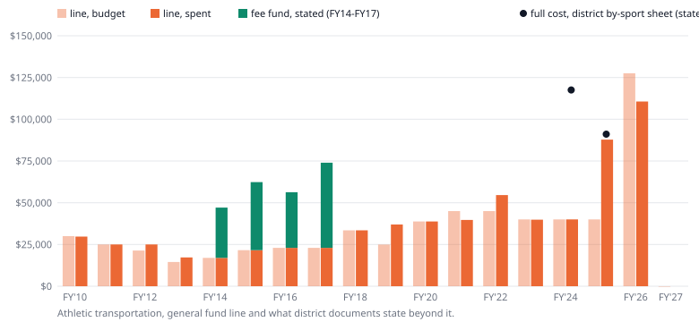
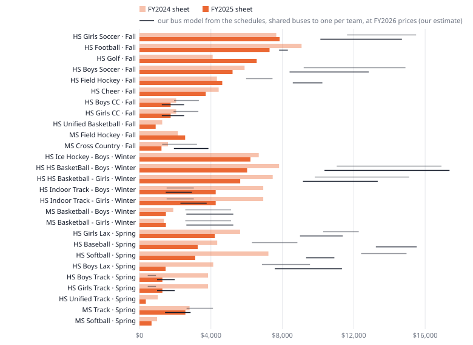
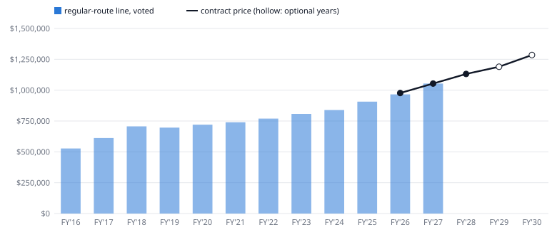
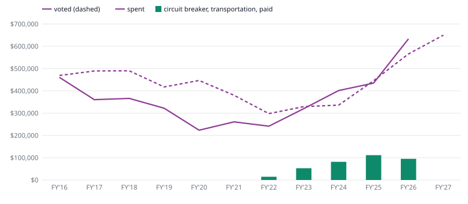

# School transportation: what the buses cost, and who pays

**What Lunenburg spends on school buses — the school day against athletics, budgeted and spent, every year since FY2010 — athletics sport by sport, and what the new Dee Bus contract fixes through FY2028.**

## The short version

Buses are getting more expensive, in special education and in the regular-route contract. The state repays only a slice of special education busing. The athletic line rose because the district moved that cost from player fees to the town budget, mostly taxes.

**What the buses cost, spent at the close of each year**

| | FY2023 | FY2024 | FY2025 | FY2026 |
|---|---:|---:|---:|---:|
| Regular routes | $837,900 | $917,525 | $907,200 | $976,500 |
| Special education | $320,244 | $401,402 | $434,922 | $633,291 |
| Athletics, town line | $39,880 | $40,000 | $87,822 | $110,650 |
| Band and music trips | $7,565 | $4,205 | $5,205 | $3,902 |
| **All school buses, town** | $1,205,589 | $1,363,132 | $1,435,149 | $1,724,343 |
| Athletics, all payers (district sheet) | — | $117,555 | $91,066 | — |

The town’s general fund at the year-end close, paid plus still owed. The last row is a sheet the district built, not the ledger; it adds what the families’ fee fund paid.

**1. The facts, FY2026**

| | |
|---:|---|
| $1,724,343 | all school buses, spent, FY2026 |
| $976,500 | regular routes |
| $633,291 | special education vans, not the Dee Bus contract |
| $110,650 | athletics, on the town budget |
| 11 | buses on regular routes *(contract)* |
| 180 | school days a bus is paid for *(contract)* |
| $485–$515 | one bus, one school day *(contract)* |
| $6.50 | a mile, field and athletic trips *(contract)* |
| $130 | an hour of the driver waiting *(contract)* |
| 176 | athletic bus trips, from the posted schedules *(our estimate)* |
| $94,993 | repaid by the state, special education only |
| — | children who ride *(not published)* |
| — | special education vans and monitors *(not published)* |
| — | one van, one school day *(not published)* |

**2. How it is changing**

| | |
|---:|---|
| +10.1% | a year, special education, since FY2019 |
| +4.9% | a year, regular routes, since FY2019 |
| 2.5% | a year: the most the levy may grow, no override *(law)* |
| +7.9% | contract price, into FY2027 *(contract)* |
| +7.4% | contract price, into FY2028 *(contract)* |
| $1,131,390 | regular routes in FY2028, already fixed *(contract)* |
| $67,555 | special education past its FY2026 budget |
| 55% | of a bid-form trip is waiting: $520 of $942.50 *(contract)* |

**3. Who pays, and what the budget shows**

| | |
|---:|---|
| 5.5% | of all buses repaid by the state |
| 71% | of town budget revenue is property tax, FY2026 projection |
| $0 | state aid for regular routes and athletics |
| $40,000 | athletics on the town budget, FY2024 |
| $117,555 | athletic buses, all payers, FY2024: district sheet |
| +11.2% | school-day buses, FY2027 budget |
| +2.4% | all buses together, FY2027 budget |
| $127,550 | athletic buses cut from FY2027 |

**4. What it adds up to**

1. **Buses are growing 2 to 4 times as fast as the levy may.** Rests on +10.1%, +4.9%, 2.5%.
2. **The biggest piece, regular routes, is priced by contract through FY2028.** Rests on $976,500, $485–$515, +7.9%, +7.4%, $1,131,390.
3. **Special education grows fastest, and nothing published counts what it buys.** Rests on $633,291, +10.1%, $67,555, not published.
4. **The FY2027 total looks flat because athletic buses were cut, not because buses got cheaper.** Rests on +11.2%, +2.4%, $127,550.
5. **The state repays a small share, and nothing for regular routes or athletics.** Rests on $94,993, 5.5%, $0.
6. **Athletic buses moved from player fees to the town budget, which property taxes mostly pay for.** Rests on $110,650, $40,000, $117,555, 71%.

**Mixed picture.** *Are buses getting more expensive, and where?* **Yes, in two places. Since FY2019 special education buses rose 97% and regular routes 40%, both faster than the 2.5% a levy may grow.**

- Spent at the close of the year: special education $322,047 in FY2019 and $633,291 in FY2026, 10.1% a year; regular routes $696,600 and $976,500, 4.9% a year. *(measured; [6. Special education transportation](#6-special-education-transportation))*
- Regular routes are priced in advance: the contract fixes $1,131,390 for FY2028, 15.9% more than FY2026 paid. *(measured; [The Dee Bus contract](#4-the-dee-bus-contract-what-is-fixed-and-what-the-7-6-was))*
- Athletic buses on the town line went from $36,974 to $110,650, but the district’s own sheet already put them at $117,555 in FY2024 and $91,066 in FY2025: the town budget, mostly taxes, took over what player fees paid. *(measured; [2. Athletic transportation: what it costs and who has paid](#2-athletic-transportation-what-it-costs-and-who-has-paid))*
- FY2027 budgets school-day buses 11.2% higher; cutting athletic buses, $127,550, made the total look like 2.4%. *(measured; [FY2027: the school-day rise under a flat-looking total](#fy2027-the-school-day-rise-under-a-flat-looking-total))*
- The district put its FY2026 special education rise down to more vans and monitors. Nothing published counts either, so price and volume cannot be told apart. Would settle it: the special education van contract and a count of routes by year, from the district. *(not published)*

**Mixed picture.** *Does state money or the bus fee offset the cost?* **Only a little. The state repaid $94,993 in FY2026, all for special education. The bus fee did not cut what the town spends on buses.**

- The state’s circuit breaker repays part of busing children placed out of district: $14,596 in FY2022, $111,560 at its FY2025 peak, $94,993 in FY2026. *(measured; [5. What pays for it: the fee, the fee fund, the state](#5-what-pays-for-it-the-fee-the-fee-fund-the-state))*
- Set beside FY2026 spending, that is 15.0% of special education buses and 5.5% of all buses. It repays the year before’s claims, not that year’s buses. *(measured; [5. What pays for it: the fee, the fee fund, the state](#5-what-pays-for-it-the-fee-the-fee-fund-the-state))*
- Regular routes and athletics get nothing from the state: Lunenburg is not a regional district, and the Cherry Sheet shows no regional busing aid in any year FY2010 to FY2027. *(measured; [5. What pays for it: the fee, the fee fund, the state](#5-what-pays-for-it-the-fee-the-fee-fund-the-state))*
- The Finance Committee was told the new bus fee cut the line by $11,000. The line was voted $11,000 below the contract, then $11,000 was moved back in during the year, so the school budget still paid the whole contract. *(on the record; [Finance Committee minutes, 2025-03-20](/docs/minutes/text/finance-committee/2025-03-20-minutes-7010.txt); [The bus fee and the general fund](#the-bus-fee-and-the-general-fund))*
- Where the fees are booked is not established; the only account named for them, in the school choice fund, took in $52,717 in FY2026 and spent nothing on buses. Would settle it: the account the bus fee payments are deposited to, from the Town Accountant. *(not published)*

**Does not match.** *Is special education busing budgeted right?* **Special education buses spent $67,555 more than their FY2026 budget, and no transfer covered it.**

- Voted $565,734; $633,291 spent by the close of the year. No school bus line has run further past its budget in any year back to FY2010. *(measured; [Lines that closed the year past their revised budget](#lines-that-closed-the-year-past-their-revised-budget))*
- FY2027 budgets $649,953 for the line, $16,662 above what FY2026 spent. A Special Education Reserve Fund, accepted on 18 November 2025, exists for unbudgeted costs like this one. *(measured; [Lines that closed the year past their revised budget](#lines-that-closed-the-year-past-their-revised-budget))*
- It is not a one-off. From FY2017 to FY2022 the same line was budgeted $747,316 above what it spent; then it was cut, and it overran in FY2024 and FY2026. *(measured; [Special education: budgeted above its spending for years, then below it](#special-education-budgeted-above-its-spending-for-years-then-below-it))*
- A budget set from last year’s spending would miss in just this way; so would children’s placements changing after the budget is set. Nothing here tests either. *(a hypothesis — nothing here tests it; [Special education: budgeted above its spending for years, then below it](#special-education-budgeted-above-its-spending-for-years-then-below-it))*
- How many vans, monitors and routes the line pays for is not published, so a higher price cannot be told from more children carried. Would settle it: the special education van contract and a count of routes by year, from the district. *(not published)*

**Matches.** *Do the regular bus routes match the contract?* **Regular bus routes now cost exactly what the Dee Bus contract says, and the FY2027 budget carries its price, $1,053,360, to the dollar.**

- FY2025 spent its budget exactly, $907,200. FY2026 spent the contract’s first-year price exactly, $976,500. *(measured; [Regular routes: the budget against the contract](#regular-routes-the-budget-against-the-contract))*
- Under the contract before this one the line overran: FY2023 by $29,925, and FY2024 by $49,925 even after $28,800 was moved in. *(measured; [Lines that closed the year past their revised budget](#lines-that-closed-the-year-past-their-revised-budget))*
- The price is fixed but not flat: it rises 7.9% into FY2027 and 7.4% into FY2028, against the 2.5% a levy may grow in a year without an override. The contract ends on 30 June 2028. *(measured; [The Dee Bus contract](#4-the-dee-bus-contract-what-is-fixed-and-what-the-7-6-was))*
- The contract before this one has not been published, so neither why FY2024 cost more than FY2025 nor whether FY2026’s 7.6% rise was price or an extra bus can be told. Would settle it: the Dee Bus contract that ran to June 2025, requested 9 October 2026. *(not published)*

**Mixed picture.** *How does the athletic fee fund play into bus costs?* **In FY2024 the town paid $40,000 of athletic buses and player fees the rest. From FY2025 the district moved that cost to the town budget, mostly taxes.**

- The district’s by-sport sheet puts FY2024 athletic buses at $117,555; its second sheet prints $81,553 for the 24 sports both list. Either way, well above $40,000. *(measured; [2. Athletic transportation: what it costs and who has paid](#2-athletic-transportation-what-it-costs-and-who-has-paid))*
- In FY2025 $47,822 was moved into the town line, to $87,822, to “reclassify expenses that had been charged against the revolving account”. *(on the record; [School Committee minutes, 2025-04-16](/docs/minutes/text/school-committee/2025-04-16-minutes-7171.txt); [2. Athletic transportation: what it costs and who has paid](#2-athletic-transportation-what-it-costs-and-who-has-paid))*
- The same year the fee fund’s high school purchase-of-service account, which carried buses with officials and ice time, fell from $115,994 to $26,685. *(measured; [The athletic fee fund: receipts against spending](#the-athletic-fee-fund-receipts-against-spending))*
- FY2027 cut the town line to $0. On 26 August 2026 $10,000 was restored from the town and $50,000 put back on the fee fund. *(on the record; [School Committee minutes, 2026-08-26](/docs/minutes/text/school-committee/2026-08-26-minutes-7980.txt); [The FY2027 restoration: the plan against the sheet and the fund](#the-fy2027-restoration-the-plan-against-the-sheet-and-the-fund))*
- In FY2026 that fee fund account spent $113,602 again while the town line paid $110,650 for athletic buses. What the fund paid for is not published. Would settle it: the fee fund’s purchase-of-service detail by vendor, and its balance at each 30 June, from the Town Accountant. *(not published)*

**Can’t tell yet.** *Which sport’s buses cost most? Can we trust the figures?* **Track costs most on the district’s sheet, $13,864 in FY2024. Its posted schedule shows far fewer away meets than the sheet has charges.**

- Boys’ and girls’ indoor track each print $6,931.75 for FY2024. Added, $13,863.50 is ahead of football’s $9,078.50 and girls’ soccer’s $7,662.00. *(measured; [Which sport’s buses cost most](#which-sport-s-buses-cost-most-track-once-its-two-rows-are-added-together))*
- The sheet’s formula for it holds 14 charges; the schedule lists 5 away meets per team. Our model, one bus a meet with four hours’ waiting at FY2026 rates, puts each team’s at $3,042.00. *(our estimate; [The sheet against the schedules](#the-sheet-against-the-schedules))*
- The other way: 5 sport-years print less than the miles alone would cost. Unified track’s FY2025 $355.00 covers 3 away meets, $1,008.15 of miles at FY2026 rates. *(our estimate; [The sheet against the schedules](#the-sheet-against-the-schedules))*
- At the School Committee, members said the indoor track league meet had moved to the Reggie Lewis Center in Boston, and that the bus is billed in full while it waits there. *(machine captions — check the video; [School Committee, 2025-03-12, video at 1:48:16 (machine captions)](https://www.youtube.com/watch?v=b7caO9Kd7VA&t=6496s))*
- Whether a bus went, was shared, or waited four hours is not recorded, so neither the sheet nor our model can be checked trip by trip. Would settle it: Dee Bus’s athletic invoices, each trip’s date, team, miles and hours waiting, from the Business Office. *(not published)*

---

## The evidence, answer by answer

Each answer at the top rests on one of these. Each is one measured thing set against another it was supposed to equal; causes are hypotheses wherever they appear, and say so.

### Lines that closed the year past their revised budget

**Special education buses closed FY2026 $67,555 past their budget, and no transfer covered it.** FY2027 budgets $16,662 above what FY2026 spent, after spending rose 45.6% in one year.

The **revised** budget is the voted budget after every transfer made during the year. A line that spent more than that closed the year overdrawn.

| FY | line | revised budget | spent at the close | past revised by | transfers during the year (negative: out) |
|---|---|---:|---:|---:|---:|
| FY2010 | Regular routes | $464,583 | $470,434 | $5,851 | -$28,437 |
| FY2011 | Regular routes | $424,380 | $450,011 | $25,631 | — |
| FY2012 | Regular routes | $403,200 | $414,450 | $11,250 | — |
| FY2012 | Special education transportation | $270,660 | $309,766 | $39,106 | $660 |
| FY2013 | Special education transportation | $418,814 | $440,499 | $21,685 | $70,754 |
| FY2014 | Special education transportation | $395,702 | $444,752 | $49,050 | — |
| FY2015 | Regular routes | $507,920 | $527,580 | $19,660 | — |
| FY2015 | Special education transportation | $415,770 | $480,819 | $65,048 | $282 |
| FY2022 | Athletic transportation | $47,022 | $54,567 | $7,545 | $2,022 |
| FY2023 | Regular routes | $807,975 | $837,900 | $29,925 | — |
| FY2023 | Band and music trips | $6,100 | $7,565 | $1,465 | — |
| FY2024 | Regular routes | $867,600 | $917,525 | $49,925 | $28,800 |
| FY2024 | Special education transportation | $338,837 | $401,402 | $62,565 | $2,890 |
| FY2026 | Special education transportation | $565,735 | $633,291 | $67,555 | $1 |

**FY2026, special education: $67,555 past its revised budget**, the largest overrun on any transportation line in a series that begins in FY2010. Voted $565,734, revised to $565,735, $620,025 paid out and $13,265 still committed at the close. The FY2027 budget for the line is $649,953, $16,662 above what FY2026 spent. The Finance Committee was shown that figure on 26 February 2026: *“Budgeted for Special Education Transportation: $649,953”* ([minutes](/docs/minutes/text/finance-committee/2026-02-26-minutes-7673.txt)).

**FY2024, both school-day lines: $112,490 past their revised budgets together.** Regular routes $49,925 past, after $28,800 was transferred in; special education $62,565 past. And FY2024’s regular routes spent $917,525, more than FY2025’s whole year, $907,200. Both years ran under the contract before the current one, which is not held, so what the extra was cannot be told (registered: *Why FY2024’s regular-route bus spending was higher than FY2025’s*). A Finance Committee member asked for the bus contracts that spring (section 4).

### Special education: budgeted above its spending for years, then below it

**From FY2017 to FY2022 the special education bus line was budgeted $747,316 above its spending.** Its FY2022 budget fell to $297,843, the lowest since FY2012; it then ran over in FY2024 and FY2026.

From FY2016 to FY2023 the line came in under its voted budget every year, by $8,538 to $223,308, $764,970 in all. From FY2017, the first year the gap passed $100,000 — our threshold — to FY2022, the year the budget was cut to $297,843, the gap was $747,316; $348,067 of it fell in FY2017 to FY2019, before the school closures. Then the line ran over its voted budget: $65,455 in FY2024; $67,557 in FY2026. The year-by-year is in section 6.

*What the data shows:* a budget that trailed its spending in both directions. *What it does not show:* why. *A hypothesis, untested:* a budget set from the prior year’s actual would draw this shape, and so would placements arriving and leaving between the budget and the year. The van contract and a count of routes by year would settle it (registered: *How many vans, monitors and routes special education transportation pays for, and at what rates*).

### Regular routes: the budget against the contract

**Regular routes are now a line a board can plan to the dollar.** FY2025 spent its budget exactly, $907,200; FY2026 spent its revised budget exactly, $976,500, the contract’s price; and the FY2027 budget carries the contract’s second-year price, $1,053,360, to the dollar. The contract fixes FY2028 too, at $1,131,390. That control was not there before: the same line closed FY2023 and FY2024 past its revised budget (the table above). The contract and its rates are in section 4.

### FY2027: the school-day rise under a flat-looking total

**FY2027’s school-day bus budget rises 11.2%; the transportation total rises only 2.4%.** Cutting athletic buses, $127,550, offset 74% of the $172,079 school-day rise.

| line | FY2026 voted | FY2027 balanced budget | change |
|---|---:|---:|---:|
| Regular routes | $965,500 | $1,053,360 | +$87,860 |
| Special education transportation | $565,734 | $649,953 | +$84,219 |
| Athletic transportation | $127,550 | $0 | -$127,550 |
| Band and music trips | $4,000 | $0 | -$4,000 |
| **school day** (regular + special education) | **$1,531,234** | **$1,703,313** | **+$172,079, 11.2%** |
| **all transportation** | **$1,662,784** | **$1,703,313** | **+$40,529, 2.4%** |

The athletic cut, $127,550, offsets 74.1% of the school-day rise. Budget to budget throughout; the regular-route rise is the contract’s second-year price.

### The bus fee and the general fund

**In the bus fee’s first year, the general fund still paid the full $976,500 bus contract.** The fee’s candidate account took in $52,717; its fund spent nothing on buses. What does the fee pay for?

In FY2026, the fee’s first year, regular routes were voted $965,500 and spent $976,500 — the contract’s full price, all of it from the general fund after $11,000 was transferred in. The candidate fee account in the school choice fund took in $103,345.48 across FY2025 and FY2026 (section 5). In every year FY2023 to FY2026 that fund has **no expense account coded to transportation** — by function 3300, by the transportation object codes, or by description — and its transfer to the general fund is **zero**. So on this ledger the fee’s effect on what the town paid for regular routes is nil. What the fee does pay for is not stated in any document held here; that the fund 1308 receipts are the fees remains a hypothesis (registered: *Whether the school choice fund’s SCH. CHOICE BUS FEE account is where the student bus fees are booked*).

### The athletic fee fund: receipts against spending

**The athletic fee fund spent $284,723 more than it took in over FY2023 and FY2024.** Over FY2025 and FY2026 it took in $140,718 more, after costs were reclassified off it. FY2027 draws $50,000.

Fund 1301, every account, at the year-end close. Receipts are the high school and middle school user charges; spending is expended plus still committed.

| FY | receipts | spending | receipts less spending | of which: high school purchase of service | high school salaries |
|---|---:|---:|---:|---:|---:|
| FY2023 | $144,949.68 | $314,863.84 | -$169,914.16 | $179,392.94 | $60,611.88 |
| FY2024 | $135,765.36 | $250,574.63 | -$114,809.27 | $115,993.84 | $107,705.32 |
| FY2025 | $131,481.37 | $32,796.47 | $98,684.90 | $26,685.06 | -$5,337.00 |
| FY2026 | $188,944.46 | $146,911.44 | $42,033.02 | $113,602.40 | $30,513.84 |

The district’s FY2026 budget overview says the *“athletic revolving can not support these increased costs”*. Across FY2023 and FY2024 the fund spent $284,723 more than it took in, which fits that. Across FY2025 and FY2026 it took in $140,718 more than it spent — **after** costs moved off it onto the town line: $47,822 was transferred into the general fund athletic line in FY2025, and the fund’s high school salaries account closed that year at -$5,337.00, which is what a reclassification out looks like (our reading). The FY2027 plan draws $50,000 from it (section 2).

**One thing not yet explained.** In FY2026 the town line paid $110,650 for athletic buses, and the fund’s high school purchase-of-service account — where buses used to be charged, with officials and ice time — spent $113,602.40, about what it spent in FY2024, $115,993.84, when it still carried most of them. Equally consistent with that: officials and ice time rose; some buses are still charged to the fund; reclassifications landed in a different year. Nothing published separates them (registered: *What the athletic fee fund’s high school purchase-of-service account paid for in FY2026*).

**The year-end balances are printed, on different bases.** Before them the last published was $98,376.41 at 30 June 2020, in the Finance Committee’s special revenue fund workbook (`budget-workbooks/finance-committee/fund-balances/fy20-srf.xlsx`, stated). Each later 30 June, and the cashbook’s running total within the year, is on [the fee fund’s own page](/athletics/fee-fund-history): by our running total of the cashbook the fund’s cash went below zero inside FY2024, our reading of the order of postings (registered: *What the athletic fee fund held at each 30 June, FY2021 to FY2026*).

### The FY2027 restoration: the plan against the sheet and the fund

**The FY2027 plan puts 83% of restored athletic buses back on the athletic fee fund.** In March 2025, moving them off it was called a correction. Nothing published yet says which practice holds.

On 26 August 2026 the Superintendent told the School Committee *“the verified transportation cost was approximately $58,880, which she rounded to $60,000. Of that amount, $10,000 would come from the additional appropriation and $50,000 from the athletic revolving account.”* ([minutes](/docs/minutes/text/school-committee/2026-08-26-minutes-7980.txt)). That is 83.3% of the restoration on the athletic fee fund and 16.7% on the town. In FY2024 the town line was $40,000 of $117,555 on the district’s by-sport workbook, 34.0% — the higher of its two sheets, so on the lower one the town’s share would be larger. On 12 March 2025 a School Committee member called the move onto the town line a correction (section 2). The Committee voted the plan the same night: *“$10,000 toward the restoration of high school athletic transportation, with additional transportation funding to come from the athletic revolving fund. Ms. Young seconded the motion. The motion passed, 3-0-1”* ([minutes](/docs/minutes/text/school-committee/2026-08-26-minutes-7980.txt)). Both are measured; nothing published yet says which practice now holds.

**The estimate against the sheet.** She explained that *“the reduced cost resulted from scheduling more competitions closer to Lunenburg, increasing home competitions, and using actual schedules and prior-year spring costs to obtain a more accurate transportation estimate”* ([minutes](/docs/minutes/text/school-committee/2026-08-26-minutes-7980.txt)). The district’s own by-sport workbook puts FY2025 high school athletic buses at $81,067.32, and the contract’s rates rise from FY2026 to FY2027: $6.50 to $6.65 a mile, $130.00 to $140.00 an hour of waiting. If $58,880 is short, the difference lands on the fee fund or the town line. A comparison, not a forecast.

### The FY2027 estimate against the posted schedules

**FY2027’s autumn schedule puts 45.8% of high school games at home; FY2026’s put 53.9%.** The FY2027 estimate credits more home games. Away trips average 39.9 miles round trip, against 41.3 in FY2026.

Her two reasons can be read off the schedules the district posts: the share of high school games played at home, and how far the away games are. Like for like: only the high school teams whose FY2027 schedule for the season is posted in full, the same teams in every year, canceled and postponed games left out. A season is compared only if it had begun when the schedules were read, 2026-10-11. Miles are round-trip driving miles from the high school, our measurement; an away game whose venue has no distance is left out of the average.

| season | FY | teams compared | games | at home | home share | away | average round-trip miles per away game (games measured) |
|---|---|---:|---:|---:|---:|---:|---:|
| fall | FY2024 | 10 | 141 | 67 | 47.5% | 74 | 44.1 (67) |
| fall | FY2025 | 10 | 125 | 59 | 47.2% | 66 | 41.0 (63) |
| fall | FY2026 | 10 | 141 | 76 | 53.9% | 65 | 41.3 (58) |
| fall | FY2027 | 10 | 131 | 60 | 45.8% | 71 | 39.9 (56) |
| winter (not compared) | FY2024 | 5 | 63 | 31 | 49.2% | 32 | 41.3 (30) |
| winter (not compared) | FY2025 | 5 | 72 | 38 | 52.8% | 34 | 49.6 (31) |
| winter (not compared) | FY2026 | 5 | 69 | 30 | 43.5% | 39 | 43.0 (37) |
| winter (not compared) | FY2027 | 5 | 61 | 33 | 54.1% | 28 | 40.5 (28) |
| spring | FY2027 | — | — | — | — | — | not posted |

Left out of the autumn comparison because its FY2027 schedule is posted short: golf (boys varsity). Winter had not begun at the reading, so it is shown and not compared; posted short and left out: basketball (boys junior varsity - jv2), hockey (boys varsity), track & field - indoor (boys varsity), track & field - indoor (girls varsity). As posted so far, the winter teams shown have 54.1% of games at home against 43.5% in FY2026 — the direction the estimate describes — but the season has not begun and its schedules can still change. Spring is not posted.

**What the schedule so far would cost — OUR ESTIMATE, at FY2027 rates** ($6.65 a mile, $140.00 an hour waiting, four hours a trip):

| high school, as scheduled | away team-games | shared buses | of which waiting | one bus per team-game | of which waiting |
|---|---:|---:|---:|---:|---:|
| FY2027 autumn, as posted | 73 | $37,111 | $26,320 | $56,186 | $40,880 |
| FY2027 winter, posted so far | 39 | $17,164 | $11,760 | $31,991 | $21,840 |
| FY2026 autumn | 77 | $46,640 | $31,733 | $61,872 | $43,120 |
| FY2026 winter | 75 | $43,605 | $30,240 | $60,603 | $42,000 |
| FY2026 spring | 61 | $39,580 | $27,440 | $48,843 | $34,160 |

The FY2027 schedule posted so far — the autumn and part of the winter — is priced at $54,275 to $88,178. That is a **partial year**, set beside an estimate of $58,880 for the whole of it. To give a full year for scale only, OUR assembly: FY2027’s autumn as posted with FY2026’s winter and spring, all at FY2027 rates, comes to $120,296 with shared buses and $165,633 with one bus per team-game. Of that, the miles alone are $36,296 to $48,593; the rest is waiting, and the waiting is our four hours. **Read the other way:** on that assembled year, with buses shared, the estimate leaves room for about 1.1 hours of paid waiting a trip. Nothing here says what her estimate assumed — the minutes say it used actual schedules and prior-year spring costs, and the worksheet is not published (registered: *How the district built its FY2027 athletic transportation estimate*).

### Which sport’s buses cost most: track, once its two rows are added together

**The district’s two athletic bus sheets price the same FY2024 sports at $113,766 and $81,553.** Both are above the $40,000 town line. Nothing published says which sheet is right.

**Read row by row, the district’s by-sport workbook’s costliest row in FY2025 is girls soccer, and its outdoor track rows are among the cheapest. Read as teams, track leads.** Boys’ and girls’ indoor track print the same transportation figure, $6,931.75 each in FY2024 and $4,267.50 each in FY2025, which is one bus split in two (section 3 lists every paired row). Added back together:

| rank | FY2024, by team | | FY2025, by team | |
|---:|---|---:|---|---:|
| 1 | HS Indoor Track, boys and girls | $13,863.50 | HS Indoor Track, boys and girls | $8,535.00 |
| 2 | HS Football | $9,078.50 | HS Girls Soccer | $7,849.50 |
| 3 | HS BasketBall - Boys | $7,817.50 | HS Football | $7,284.80 |
| 4 | HS Outdoor Track, boys and girls | $7,674.00 | HS Golf | $6,565.00 |
| 5 | HS Girls Soccer | $7,662.00 | HS Ice Hockey - Boys | $6,215.00 |

On the workbook, indoor track is first in both years. On the Finance Committee’s copy of the second district sheet, which prints indoor track as one row, it is first in FY2025 and number 4 in FY2024, at $8,169.50 and $6,085.00. Two hand-built sheets, $7,778.50 apart on the same team in FY2024; neither is an invoice, and this page picks neither (rule 13a).

**Against the schedules.** ArbiterLive lists 5 away meets for each indoor track team in FY2024, and 4 for the boys and 5 for the girls in FY2025. The sheet’s FY2024 formula holds 14 charges, halved between the two rows. Our bus model, one bus a meet with four hours of waiting at FY2026 rates, puts FY2024’s listed meets at $3,042.00 a team — **our estimate**, and less than half what the sheet prints. Either the schedule is short, or the waits were long, or both; the recordings below speak to the second, and nothing published measures either (section 3, *The sheet against the schedules*).

**Why outdoor track looks cheapest.** Only in FY2025, and only on rows whose season total the workbook prints as $0.00: the spring rows sum to $18,242.50, -46.1% against FY2024’s $33,835.50. *A hypothesis:* the spring section was unfinished when the sheet was made; nothing here tests it (registered: *Whether the FY2025 spring section of the district’s by-sport athletics workbook is complete*).

**What was said about track, in the recordings.** The town’s minutes of these meetings do not record it; our machine captions of the recordings do. Captions are a finding aid and not a record, so each is summarised in our words, no figure is taken from it, and each links to the video at the moment — check it there.

- School Committee, 2024-02-28, [video at 2:05:35](https://www.youtube.com/watch?v=pn_OXfPbl9w&t=7535s) (machine captions): The district told the Committee it pays Dee Bus for every hour a bus waits at an event, that track competitions run long, and that most of the charge is the waiting.
- School Committee, 2025-03-12, [video at 1:48:16](https://www.youtube.com/watch?v=b7caO9Kd7VA&t=6496s) (machine captions): Members discussed indoor track: the league meet had moved to the Reggie Lewis Center in Boston, Lunenburg has no indoor facility of its own, and the bus is billed in full while it waits.
- Athletic Advisory Council, 2025-01-27, [video at 0:31:41](https://www.youtube.com/watch?v=_tYwHQu995w&t=1901s) (machine captions): A bus taken to a track meet at the Reggie Lewis Center waits there most of the day; a van was raised as a cheaper way to carry a small group.

That fits the workbook read as teams: a meet in Boston is a long drive and a long wait, and the contract bills waiting by the hour, $130.00 in FY2026 and $140.00 in FY2027. It does not measure any of it. No record of a single athletic trip — its date, team, miles or hours waiting — is published for any year (registered: *How many athletic bus trips each sport took, and what each trip cost*).

### The contract against this site’s model

**The signed bus contract rises 7.4% into FY2028; this site’s model grows the line 6%.** That leaves the model’s FY2028 regular routes $14,828 under a price already fixed.

The contract’s regular-route price rises 7.9% into FY2027 and 7.4% into FY2028, both already signed. This site’s model (`model/finance.py`, published in `model.json`) starts the line at the FY2027 budget, $1,053,360, and grows it at a default 6% a year: $1,116,562 for FY2028, **$14,828 under the $1,131,390 the contract fixes**. A contracted price is stronger evidence than a default rate (rules 4 and 6), so this changes an assumption; it is reported here and the model has not been changed. Special education transportation is not in that line; the model grows it with special education.

### What this does not show

- **Why any line overran.** Every cause offered above is a hypothesis; the van contract, the earlier bus contract and the fee fund’s account detail would each settle one.
- **That anybody did anything wrong.** A variance is a difference between two figures, not a finding of fault, and several of these have more than one innocent explanation.
- **The fee fund’s balance**, at any 30 June after 2020.

## The charts

## 1. The school day against athletics

### In plain terms

Almost all of what the schools spend on buses is the school day: the eleven Dee Bus buses on regular routes and the special education vans. Athletic buses were 6.4% of spending in FY2026 and have been between 1.8% and 6.4% every year since FY2010. That is the general fund only — athletic buses the fee fund paid for are not in it (section 2).

### The evidence

Budget is the original appropriation voted before the year. Spent is expended plus still committed at the year-end close. **The two are side by side and never combined**: the athletic share is computed once on spending and once on budget.

| FY | school day, budget | school day, spent | athletic, budget | athletic, spent | band, budget | band, spent | athletic share of spending | athletic share of budget | source |
|---|---:|---:|---:|---:|---:|---:|---:|---:|---|
| FY2010 | $793,020 | $697,310 | $30,000 | $29,744 | $5,100 | $3,350 | 4.1% | 3.6% | FinCom workbook |
| FY2011 | $724,380 | $717,259 | $25,000 | $25,000 | $5,500 | $3,545 | 3.4% | 3.3% | FinCom workbook |
| FY2012 | $673,200 | $724,216 | $21,400 | $24,992 | $4,950 | $2,214 | 3.3% | 3.1% | FinCom workbook |
| FY2013 | $824,660 | $948,263 | $14,500 | $17,276 | $5,650 | $3,498 | 1.8% | 1.7% | FinCom workbook |
| FY2014 | $872,302 | $912,386 | $17,000 | $17,000 | $5,900 | $4,417 | 1.8% | 1.9% | FinCom workbook |
| FY2015 | $923,408 | $1,008,399 | $21,600 | $21,600 | $6,900 | $2,168 | 2.1% | 2.3% | FinCom workbook |
| FY2016 | $996,626 | $988,088 | $23,000 | $23,000 | $4,100 | $2,471 | 2.3% | 2.2% | FinCom workbook |
| FY2017 | $1,101,250 | $986,037 | $23,000 | $23,000 | $4,250 | $1,927 | 2.3% | 2.0% | FinCom workbook |
| FY2018 | $1,196,500 | $1,041,184 | $33,500 | $33,500 | $4,250 | $2,740 | 3.1% | 2.7% | FinCom workbook |
| FY2019 | $1,114,185 | $1,018,647 | $24,975 | $36,974 | $4,500 | $6,075 | 3.5% | 2.2% | FinCom workbook |
| FY2020 | $1,166,658 | $732,390 | $38,801 | $38,795 | $6,900 | $2,900 | 5.0% | 3.2% | FinCom workbook |
| FY2021 | $1,120,209 | $928,696 | $45,000 | $39,703 | $4,900 | $0 | 4.1% | 3.8% | FinCom workbook |
| FY2022 | $1,067,343 | $968,815 | $45,000 | $54,567 | $5,100 | $2,620 | 5.3% | 4.0% | FinCom workbook |
| FY2023 | $1,137,335 | $1,158,144 | $40,000 | $39,880 | $6,100 | $7,565 | 3.3% | 3.4% | MUNIS |
| FY2024 | $1,174,747 | $1,318,927 | $40,000 | $40,000 | $6,700 | $4,205 | 2.9% | 3.3% | MUNIS |
| FY2025 | $1,352,528 | $1,342,122 | $40,000 | $87,822 | $8,500 | $5,205 | 6.1% | 2.9% | MUNIS |
| FY2026 | $1,531,234 | $1,609,791 | $127,550 | $110,650 | $4,000 | $3,902 | 6.4% | 7.7% | MUNIS |
| FY2027 | $1,703,313 | — | $0 | — | $0 | — | — | 0.0% | budget book, balanced |

The school day split, FY2026: regular routes voted $965,500 and spent $976,500; special education voted $565,734 and spent $633,291. Band trips were $3,902 spent against $4,000 voted.

**Band and music trips in FY2027.** The balanced budget carries $0 for both band transportation lines. The Finance Committee was told on 26 March 2026: *“The transportation for Middle-High Band would be reduced to $5,000.”* ([minutes](/docs/minutes/text/finance-committee/2026-03-26-minutes-7737.txt)). The book and the minute differ, and the record here does not say which held.

**A second route.** DESE’s End of Year Financial Report gives the same school-day spending as in-district transportation (function 3300) plus out-of-district transportation, general fund. It equals the town ledger’s regular plus special education lines to the dollar in FY2016, FY2017, FY2019, FY2022, FY2023, FY2024. Within $421 in FY2012, FY2013, FY2014, FY2015, FY2018. FY2020 and FY2021 differ by $135,112 in opposite directions, so the two years together tie; one payment booked in different years by the two would look like that (a hypothesis). FY2010, FY2011 differ by more, in both directions. In FY2025 DESE reports $1,365,412 against the ledger’s $1,342,122, $23,290 apart; nothing published here explains the difference (registered: *Why DESE’s FY2025 transportation spending for Lunenburg differs from the town ledger*). DESE splits in-district from out-of-district, which is not the town’s regular / special education split, so only the sum is compared.

### What this does not show

- **What athletic buses cost in all.** The general fund line is net of the athletic fee fund (rule 11), and the fund paid more of athletic transportation than the town did in every year a district document reports both as actual, FY2014 to FY2017 (section 2).
- **Cost per rider.** No count of riders is published (registered: *How many children ride the school buses, and how many pay the fee*). The only count in the record is 1,074 bus requests in June 2025, 494 of them unpaid at the time.
- **Monty Tech.** Students at the regional vocational school ride its buses; Lunenburg pays for them inside the Monty Tech assessment, whose transportation-and-operating part is not split. It is a town appropriation, not a school line, and is not on this page.

## 2. Athletic transportation: what it costs and who has paid

### In plain terms

The athletic bus line in the town budget used to be a fraction of what athletic buses cost; the athletic fee fund — what families pay to play — covered the rest. In FY2024 the district’s by-sport workbook put the cost at $117,555 while the voted line was $40,000; on the 24 sports both of its sheets print, one says $113,766 and the other $81,553, and the town has not said which is right. Either way the cost was above the line. From FY2026 the line was set to carry the full cost, and the district said so at the time. In FY2027 the balanced budget cut it to $0.

### The evidence

| FY | general fund line, budget | general fund line, spent | fee fund, stated by the district | full cost, district by-sport sheet (stated) |
|---|---:|---:|---:|---:|
| FY2014 | $17,000 | $17,000 | $30,085 | — |
| FY2015 | $21,600 | $21,600 | $40,742 | — |
| FY2016 | $23,000 | $23,000 | $33,308 | — |
| FY2017 | $23,000 | $23,000 | $50,986 | — |
| FY2018 | $33,500 | $33,500 | $27,450 (budget) | — |
| FY2019 | $24,975 | $36,974 | $40,000 (budget) | — |
| FY2020 | $38,801 | $38,795 | — | — |
| FY2021 | $45,000 | $39,703 | — | — |
| FY2022 | $45,000 | $54,567 | — | — |
| FY2023 | $40,000 | $39,880 | — | — |
| FY2024 | $40,000 | $40,000 | — | $117,555 |
| FY2025 | $40,000 | $87,822 | — | $91,066 |
| FY2026 | $127,550 | $110,650 | — | — |
| FY2027 | $0 | — | — | — |

The fee fund figures for FY2014 to FY2019 are the district’s FY19 athletics budget document (`district-budget/docs/fy19-proposed-athletics-budget.pdf`), actual to FY2017. Nothing published states the fund’s share after that; it books transportation inside one purchase-of-service account with officials, uniforms and ice time (registered: *Whether a general fund athletics line is net of the revolving fund*).

**The district’s own words.** Its FY2026 budget overview, on the athletics line: *“budgeted to cover full cost of transportation for athletics; athletic revolving can not support these increased costs”*. At the School Committee on 12 March 2025, a member: *“The cost of athletic transportation is not up 200%. The way we are accounting for athletic transportation has been corrected from past practice that was done incorrectly.”* ([minutes](/docs/minutes/text/school-committee/2025-03-12-minutes-7098.txt)).

**FY2025, the year it moved.** The line was voted at $40,000 and $47,822 was transferred in during the year, to $87,822, all of it spent. The School Committee approved the transfer on 16 April 2025: *“A fourth transfer to move funds to the athletic transportation, special detail, dues and fees and the high school after school stipends, this is the first phase move making monies available in the athletic portion of the budget. We can go back and reclassify expenses that had been charged against the revolving account.”* ([minutes](/docs/minutes/text/school-committee/2025-04-16-minutes-7171.txt)).

**FY2026, the new contract’s first athletic year**, the general fund line spent $87,126 and had $23,524 still committed at the close, $110,650 in all against $127,550 voted. Section 3 sets each sport beside its posted schedule.

### What this does not show

- **Whether teams rode more or less.** Dollars moved between two payers; no trip count is published for any year (registered: *How many athletic bus trips each sport took, and what each trip cost*).
- **That the sheet is right.** It is assembled by hand, and the district has not stood behind any per-sport figure (registered: *Which of the three published per-sport athletics cost figures is correct*).

## 3. Sport by sport: the district’s sheet and the posted schedules

### In plain terms

In FY2025 no single sport’s buses cost more than $7,850 on the district’s sheet, and the five biggest together were $33,942 of its $91,066. The schedules the district posts list 246 away games that year, to 181 different places on different days. **Our bus model** — miles to each venue at the contract’s per-mile rate, plus four hours of waiting at its hourly rate, at FY2026 prices — puts that schedule at $140,719 if teams going to the same place on the same day shared a bus, and $189,118 if every team had its own. The waiting is $94,120 to $127,920 of it, and four hours is our assumption; the miles alone are $46,599 to $61,198. The sheet’s whole total is below even the shared figure. Nobody publishes which buses ran, so the truth is not known to be anywhere in that range.

### The schedules, year by year — OUR ESTIMATE in dollars

Every game ArbiterLive lists for a Lunenburg team, FY2022 to FY2027, with canceled, postponed and rained-out games left out. The counts are the schedules’; the miles are our measurement (driving routes on OpenStreetMap, from the high school and back); the dollars are our model. **Lower bound:** one bus for each distinct date and venue, its cost shared among every Lunenburg team there. **Upper bound:** one bus for every team-game. Whether buses were shared is not recorded anywhere. FY2022 to FY2025 are priced at FY2026 rates ($6.50 a mile, $130.00 an hour waiting), because the earlier contract’s rates are not held (registered: *What the Dee Bus rates and fleet were in FY2025, so the 7.6% FY2026 increase can be split into price and buses*); FY2027 at its own, $6.65 and $140.00.

| FY | away team-games | distinct date-and-venue trips | away games with no distance | shared buses: miles | shared: waiting | **shared: total** | one bus per team: miles | per team: waiting | **per team: total** | priced at |
|---|---:|---:|---:|---:|---:|---:|---:|---:|---:|---|
| FY2022 | 219 | 148 | 11 | $34,932 | $76,960 | **$111,892** | $50,239 | $113,880 | **$164,119** | FY2026 rates |
| FY2023 | 232 | 164 | 10 | $40,597 | $85,280 | **$125,877** | $55,486 | $120,640 | **$176,126** | FY2026 rates |
| FY2024 | 255 | 189 | 17 | $44,203 | $98,280 | **$142,483** | $57,153 | $132,600 | **$189,753** | FY2026 rates |
| FY2025 | 246 | 181 | 14 | $46,599 | $94,120 | **$140,719** | $61,198 | $127,920 | **$189,118** | FY2026 rates |
| FY2026 | 240 | 176 | 21 | $42,273 | $91,520 | **$133,793** | $55,660 | $124,800 | **$180,460** | FY2026 rates |
| FY2027 | 126 | 75 | 16 | $17,142 | $42,000 | **$59,142** | $27,351 | $70,560 | **$97,911** | FY2027 rates, schedule still being posted |

A game with no listed venue, or at one of the 11 venues OpenStreetMap could not place, carries its waiting and no miles, so the miles column is a floor for those games. Left out of both bounds: 77 home games played at a venue outside Lunenburg across the six years, most of them hockey at its home rink in Fitchburg — the district lists them as home, and whether a bus carried the team is not recorded. FY2027 is the autumn as posted and the winter as far as it is posted; spring is not posted at all.

**Away games played, team by team** (counts from the schedules; a dash is a year with no away game listed):

| sport | team | FY2022 | FY2023 | FY2024 | FY2025 | FY2026 | FY2027 |
|---|---|---:|---:|---:|---:|---:|---:|
| Baseball | Boys Junior Varsity | 9 | 6 | — | 7 | 8 | — |
| Baseball | Boys Varsity | 10 | 11 | 12 | 12 | 9 | — |
| Basketball | Boys Junior Varsity - JV | — | — | — | 6 | 5 | 1 |
| Basketball | Boys Junior Varsity - JV2 | 11 | 7 | 10 | 4 | 1 | 6 |
| Basketball | Boys Middle School | 7 | 7 | 7 | 7 | 7 | 7 |
| Basketball | Boys Varsity | 12 | 12 | 13 | 11 | 12 | 9 |
| Basketball | Coed Unified | 2 | 3 | 3 | 2 | 2 | 1 |
| Basketball | Girls Junior Varsity | 9 | 12 | 8 | 6 | 9 | 9 |
| Basketball | Girls Middle School | 7 | 7 | 7 | 7 | 7 | 7 |
| Basketball | Girls Varsity | 9 | 12 | 11 | 11 | 13 | 9 |
| Cross Country | Boys Middle School | 2 | 2 | 2 | 3 | 2 | — |
| Cross Country | Boys Varsity | 4 | 3 | 5 | 3 | 4 | 8 |
| Cross Country | Coed Middle School | — | — | 1 | — | — | — |
| Cross Country | Girls Middle School | 2 | 2 | 2 | 3 | 2 | — |
| Cross Country | Girls Varsity | 4 | 3 | 5 | 3 | 4 | 8 |
| Field Hockey | Girls Junior Varsity | 5 | 6 | 4 | 3 | 7 | 5 |
| Field Hockey | Girls Middle School | 5 | 5 | 5 | 6 | 5 | — |
| Field Hockey | Girls Varsity | 8 | 7 | 6 | 10 | 7 | 8 |
| Football | Boys Junior Varsity | 3 | 4 | 7 | 3 | 4 | 3 |
| Football | Boys Varsity | 7 | 4 | 8 | 5 | 6 | 6 |
| Golf | Boys Junior Varsity | — | 1 | 2 | 3 | 3 | — |
| Golf | Boys Varsity | 9 | 7 | 7 | 7 | 7 | 1 |
| Hockey | Boys Junior Varsity | 3 | 3 | 3 | 5 | 11 | — |
| Hockey | Boys Varsity | 7 | 8 | 11 | 10 | 11 | 1 |
| Lacrosse - Boys | Boys Junior Varsity | 5 | 5 | 4 | 6 | 4 | — |
| Lacrosse - Boys | Boys Varsity | 9 | 11 | 9 | 8 | 8 | — |
| Lacrosse - Girls | Girls Junior Varsity | 5 | 4 | 4 | 3 | — | — |
| Lacrosse - Girls | Girls Varsity | 8 | 12 | 12 | 10 | 10 | — |
| Ski | Coed Varsity | 1 | — | — | — | 1 | — |
| Soccer | Boys Junior Varsity | 5 | 5 | 9 | 10 | 9 | 7 |
| Soccer | Boys Varsity | 8 | 9 | 11 | 8 | 9 | 8 |
| Soccer | Girls Junior Varsity | 5 | 7 | 8 | 8 | 7 | 8 |
| Soccer | Girls Varsity | 8 | 14 | 11 | 13 | 8 | 10 |
| Softball | Girls Junior Varsity | 7 | 7 | 8 | 5 | 5 | — |
| Softball | Girls Middle School | — | — | 5 | 6 | 2 | — |
| Softball | Girls Varsity | 11 | 12 | 13 | 10 | 13 | — |
| Track & Field - Indoor | Boys Varsity | 3 | 3 | 5 | 4 | 6 | 2 |
| Track & Field - Indoor | Girls Varsity | 3 | 3 | 5 | 5 | 6 | 2 |
| Track & Field - Outdoor | Boys Middle School | 1 | — | 3 | 2 | 1 | — |
| Track & Field - Outdoor | Boys Varsity | 1 | 4 | 1 | 3 | 2 | — |
| Track & Field - Outdoor | Coed Unified | 2 | 1 | 4 | 3 | — | — |
| Track & Field - Outdoor | Girls Middle School | 1 | — | 3 | 2 | 1 | — |
| Track & Field - Outdoor | Girls Varsity | 1 | 3 | 1 | 3 | 2 | — |

The dollars for each team and year, both bounds and the waiting part separately, are in the page’s data (`/data/transportation.json`, `schedules.teams`).

### The sheet against the schedules

The district’s sheet beside each sport’s posted schedule, for the two years the sheet carries transportation. A *charge* is one amount typed into the sheet’s formula for that cell: `=532.5+375` is two. A cell typed as a bare number is one figure, not a formula, and is marked so. Where the sheet halves a formula between two rows (`/2`), each row shows the whole formula’s charges. The model columns are **OUR ESTIMATE** at FY2026 prices.

| FY | level | sport | sheet | charges in its formula | away games listed | distinct trips | model: miles alone, shared buses | model: shared, with waiting | model: one bus per team-game | reading |
|---|---|---|---:|---:|---:|---:|---:|---:|---:|---|
| FY2024 | HS | Baseball | $4,354.00 | 12 | 12 | 12 | $1,879.80 | $6,299.80 | $8,843.25 | below the shared bound with waiting |
| FY2024 | HS | Boys CC | $2,053.75 | 7, halved | 5 | 5 | $375.37 | $1,935.37 | $3,324.10 | inside the range |
| FY2024 | HS | Boys Lax | $4,130.50 | 7 | 13 | 9 | $2,176.20 | $6,856.20 | $9,550.45 | below the shared bound with waiting |
| FY2024 | HS | Boys Soccer | $5,886.00 | 13 | 20 | 14 | $2,958.48 | $9,198.48 | $14,894.75 | below the shared bound with waiting |
| FY2024 | HS | Boys Track | $3,837.00 | 7, halved | 1 | 1 | $201.17 | $461.17 | $922.35 | above the upper bound |
| FY2024 | HS | Cheer | $4,435.50 | 7 | — | — | — | — | — | no schedule posted |
| FY2024 | HS | Field Hockey | $4,338.00 | 10 | 10 | 8 | $1,809.60 | $5,969.60 | $7,452.90 | below the shared bound with waiting |
| FY2024 | HS | Football | $9,078.50 | 13 | 15 | 15 | $5,439.20 | $13,239.20 | $13,239.20 | below the shared bound with waiting |
| FY2024 | HS | Girls CC | $2,053.75 | 7, halved | 5 | 5 | $348.72 | $1,908.72 | $3,297.45 | inside the range |
| FY2024 | HS | Girls Lax | $5,635.50 | 11 | 16 | 13 | $3,525.60 | $10,285.60 | $12,279.15 | below the shared bound with waiting |
| FY2024 | HS | Girls Soccer | $7,662.00 | 15 | 19 | 16 | $4,345.58 | $11,625.58 | $15,494.70 | below the shared bound with waiting |
| FY2024 | HS | Girls Track | $3,837.00 | 7, halved | 1 | 1 | $201.17 | $461.17 | $922.35 | above the upper bound |
| FY2024 | HS | Golf | $4,100.00 | 8 | 9 | 9 | $1,722.50 | $6,402.50 | $6,402.50 | below the shared bound with waiting |
| FY2024 | HS | HS BasketBall - Boys | $7,817.50 | 15 | 23 | 15 | $3,248.70 | $11,048.70 | $16,911.70 | below the shared bound with waiting |
| FY2024 | HS | HS Basketball - Girls | $7,463.00 | 13 | 19 | 12 | $3,575.64 | $9,815.64 | $15,104.70 | below the shared bound with waiting |
| FY2024 | HS | Ice Hockey - Boys | $6,681.50 | 10 | 14 | 14 | $2,921.75 | $10,201.75 | $10,201.75 | below the shared bound with waiting |
| FY2024 | HS | Ice Hockey - Girls | $0.00 | 0 | — | — | — | — | — | no schedule posted |
| FY2024 | HS | Indoor Track - Boys | $6,931.75 | 14, halved | 5 | 5 | $221.00 | $1,521.00 | $3,042.00 | above the upper bound |
| FY2024 | HS | Indoor Track - Girls | $6,931.75 | 14, halved | 5 | 5 | $221.00 | $1,521.00 | $3,042.00 | above the upper bound |
| FY2024 | HS | Ski Team | $0.00 | 0 | — | — | — | — | — | no schedule posted |
| FY2024 | HS | Softball | $7,222.00 | 1 typed figure | 21 | 21 | $3,313.05 | $12,413.05 | $14,956.50 | below the shared bound with waiting |
| FY2024 | HS | Unified Basketball | $1,275.00 | 4 | 3 | 3 | $640.25 | $2,200.25 | $2,200.25 | below the shared bound with waiting |
| FY2024 | HS | Unified Track | $1,030.00 | 3 | 4 | 4 | $627.90 | $2,707.90 | $2,707.90 | below the shared bound with waiting |
| FY2024 | MS | Basketball - Boys | $1,893.25 | 7 | 7 | 7 | $744.25 | $2,564.25 | $5,128.50 | below the shared bound with waiting |
| FY2024 | MS | Basketball - Girls | $1,373.25 | 6 | 7 | 7 | $744.25 | $2,564.25 | $5,128.50 | below the shared bound with waiting |
| FY2024 | MS | Cross Country | $1,595.00 | 4 | 5 | 2 | $230.76 | $1,270.75 | $3,218.15 | inside the range |
| FY2024 | MS | Field Hockey | $2,150.00 | 5 | 5 | 5 | $939.25 | $3,539.25 | $3,539.25 | below the shared bound with waiting |
| FY2024 | MS | Softball | $985.50 | 1 typed figure | 5 | 5 | $1,233.05 | $3,833.05 | $3,833.05 | **below the miles alone** |
| FY2024 | MS | Track | $2,804.00 | 4 | 6 | 4 | $559.00 | $2,639.00 | $4,115.80 | inside the range |
| FY2025 | HS | Baseball | $3,260.00 | 6 | 19 | 18 | $4,917.57 | $13,237.57 | $15,527.85 | **below the miles alone** |
| FY2025 | HS | Boys CC | $1,744.38 | 3, halved | 3 | 3 | $470.60 | $1,250.60 | $2,501.20 | inside the range |
| FY2025 | HS | Boys Lax | $1,462.50 | 2 | 14 | 9 | $2,897.71 | $7,577.71 | $11,339.25 | **below the miles alone** |
| FY2025 | HS | Boys Soccer | $5,212.38 | 3 | 18 | 13 | $2,250.74 | $8,404.07 | $12,839.45 | below the shared bound with waiting |
| FY2025 | HS | Boys Track | $1,285.00 | 7, halved | 3 | 3 | $206.05 | $986.05 | $1,972.10 | inside the range |
| FY2025 | HS | Cheer | $3,711.25 | 3 | — | — | — | — | — | no schedule posted |
| FY2025 | HS | Field Hockey | $4,634.38 | 2 | 13 | 11 | $3,038.10 | $8,584.76 | $10,241.40 | below the shared bound with waiting |
| FY2025 | HS | Football | $7,284.80 | 5 | 8 | 8 | $4,004.00 | $7,817.33 | $8,309.60 | below the shared bound with waiting |
| FY2025 | HS | Girls CC | $1,744.38 | 3, halved | 3 | 3 | $470.60 | $1,250.60 | $2,501.20 | inside the range |
| FY2025 | HS | Girls Lax | $4,222.50 | 5 | 13 | 10 | $3,791.44 | $8,991.44 | $11,386.70 | below the shared bound with waiting |
| FY2025 | HS | Girls Soccer | $7,849.50 | 4 | 21 | 15 | $2,765.97 | $10,132.63 | $14,699.75 | below the shared bound with waiting |
| FY2025 | HS | Girls Track | $1,285.00 | 7, halved | 3 | 3 | $206.05 | $986.05 | $1,972.10 | inside the range |
| FY2025 | HS | Golf | $6,565.00 | 2 | 10 | 10 | $2,182.05 | $7,382.05 | $7,382.05 | below the shared bound with waiting |
| FY2025 | HS | HS BasketBall - Boys | $6,027.50 | 3 | 21 | 12 | $4,121.00 | $10,361.00 | $17,364.75 | below the shared bound with waiting |
| FY2025 | HS | HS Basketball - Girls | $5,641.25 | 3 | 17 | 12 | $2,916.55 | $9,156.55 | $13,342.55 | below the shared bound with waiting |
| FY2025 | HS | Ice Hockey - Boys | $6,215.00 | 3 | 15 | 15 | $2,717.65 | $10,517.65 | $10,517.65 | below the shared bound with waiting |
| FY2025 | HS | Indoor Track - Boys | $4,267.50 | 3, halved | 4 | 4 | $429.65 | $1,469.65 | $2,939.30 | above the upper bound |
| FY2025 | HS | Indoor Track - Girls | $4,267.50 | 3, halved | 5 | 5 | $732.55 | $2,292.55 | $3,762.20 | above the upper bound |
| FY2025 | HS | Softball | $3,125.00 | 8, halved | 15 | 15 | $2,572.38 | $9,332.38 | $10,914.15 | below the shared bound with waiting |
| FY2025 | HS | Unified Basketball | $907.50 | 2 | 2 | 2 | $268.45 | $1,308.45 | $1,308.45 | below the shared bound with waiting |
| FY2025 | HS | Unified Track | $355.00 | 1 | 3 | 3 | $1,008.15 | $2,568.15 | $2,568.15 | **below the miles alone** |
| FY2025 | MS | Basketball - Boys | $1,479.38 | 3, halved | 7 | 7 | $806.98 | $2,626.98 | $5,253.95 | below the shared bound with waiting |
| FY2025 | MS | Basketball - Girls | $1,479.38 | 3, halved | 7 | 7 | $806.98 | $2,626.98 | $5,253.95 | below the shared bound with waiting |
| FY2025 | MS | Cross Country | $1,233.50 | 2 | 6 | 3 | $370.50 | $1,930.50 | $3,861.00 | below the shared bound with waiting |
| FY2025 | MS | Field Hockey | $2,559.00 | 2 | 6 | 6 | $1,127.75 | $4,247.75 | $4,247.75 | below the shared bound with waiting |
| FY2025 | MS | Softball | $677.50 | 1 typed figure | 6 | 6 | $1,127.75 | $4,247.75 | $4,247.75 | **below the miles alone** |
| FY2025 | MS | Track | $2,570.00 | 7 | 4 | 2 | $391.94 | $1,431.94 | $2,863.90 | inside the range |

**What the data shows.** 5 sport-years print less than the miles alone would cost on the lower bound — shared buses and no waiting at all, so the four-hour assumption plays no part: FY2025 HS Baseball, $3,260.00 against 19 away games and $4,917.57 of miles; FY2025 HS Boys Lax, $1,462.50 against 14 away games and $2,897.71 of miles; FY2025 HS Unified Track, $355.00 against 3 away games and $1,008.15 of miles; FY2024 MS Softball, $985.50 against 5 away games and $1,233.05 of miles; FY2025 MS Softball, $677.50 against 6 away games and $1,127.75 of miles. 4 of the 5 are in FY2025’s spring, the section already registered as possibly unfinished (*Whether the FY2025 spring section of the district’s by-sport athletics workbook is complete*). In the other direction, 6 sport-years print more than one bus for every listed game would cost: FY2024 HS Indoor Track - Boys, $6,931.75 against $3,042.00; FY2025 HS Indoor Track - Boys, $4,267.50 against $2,939.30; FY2024 HS Indoor Track - Girls, $6,931.75 against $3,042.00; FY2025 HS Indoor Track - Girls, $4,267.50 against $3,762.20; FY2024 HS Boys Track, $3,837.00 against $922.35; FY2024 HS Girls Track, $3,837.00 against $922.35. Indoor track’s FY2024 formula holds 14 charges against 5 meets listed per team. Across all 52 scheduled sport-years, 37 fall below the shared bound once four hours of waiting is counted — which says as much about that assumption, and about the old contract’s unknown prices, as about the sheet.

**The charges themselves changed shape.** In FY2024 the sheet’s formulas hold 195 charges with a median of $485.00, a median of 7.5 to a cell; in FY2025, 79 charges with a median of $675.00, a median of 3 to a cell. *A hypothesis:* the FY2025 figures are monthly or seasonal invoice totals rather than trips; nothing here tests it, so a FY2025 charge count is not a trip count.

**What it does not show** is which is wrong. Every one of these fits the same numbers, and the data cannot choose between them:

- *the sheet is incomplete* — charges not yet entered when it was made;
- *the schedule is incomplete* — ArbiterLive lists only what a coach posted, and track lists fewer meets than its formulas hold charges;
- *buses were shared* more widely than one date and venue — teams going the same way, a single bus dropping two teams;
- *no bus went* — a van, parents driving, or a team riding with another school;
- *a charge is not a trip* — an invoice can cover a month, or several teams;
- *waiting was not four hours* — a game is shorter, a meet in Boston longer.

What would settle it is the same document for every row: Dee Bus’s athletic invoices, each trip’s date, team, miles and hours waiting (registered: *How many athletic bus trips each sport took, and what each trip cost*).

### The district’s sheet, sport by sport

From the district’s sport-by-sport workbook; the cell is the workbook’s own.

| season | level | sport | FY2024 | FY2025 |
|---|---|---|---:|---:|
| Fall | HS | Girls Soccer | $7,662.00 | $7,849.50 |
| Fall | HS | Football | $9,078.50 | $7,284.80 |
| Fall | HS | Golf | $4,100.00 | $6,565.00 |
| Fall | HS | Boys Soccer | $5,886.00 | $5,212.38 |
| Fall | HS | Field Hockey | $4,338.00 | $4,634.38 |
| Fall | HS | Cheer | $4,435.50 | $3,711.25 |
| Fall | HS | Boys CC | $2,053.75 | $1,744.38 |
| Fall | HS | Girls CC | $2,053.75 | $1,744.38 |
| Fall | HS | Unified Basketball | $1,275.00 | $907.50 |
| Fall | MS | Field Hockey | $2,150.00 | $2,559.00 |
| Fall | MS | Cross Country | $1,595.00 | $1,233.50 |
| Winter | HS | Ice Hockey - Boys | $6,681.50 | $6,215.00 |
| Winter | HS | HS BasketBall - Boys | $7,817.50 | $6,027.50 |
| Winter | HS | HS Basketball - Girls | $7,463.00 | $5,641.25 |
| Winter | HS | Indoor Track - Boys | $6,931.75 | $4,267.50 |
| Winter | HS | Indoor Track - Girls | $6,931.75 | $4,267.50 |
| Winter | HS | Ice Hockey - Girls | $0.00 | — |
| Winter | HS | Ski Team | $0.00 | — |
| Winter | MS | Basketball - Boys | $1,893.25 | $1,479.38 |
| Winter | MS | Basketball - Girls | $1,373.25 | $1,479.38 |
| Spring | HS | Girls Lax | $5,635.50 | $4,222.50 |
| Spring | HS | Baseball | $4,354.00 | $3,260.00 |
| Spring | HS | Softball | $7,222.00 | $3,125.00 |
| Spring | HS | Boys Lax | $4,130.50 | $1,462.50 |
| Spring | HS | Boys Track | $3,837.00 | $1,285.00 |
| Spring | HS | Girls Track | $3,837.00 | $1,285.00 |
| Spring | HS | Unified Track | $1,030.00 | $355.00 |
| Spring | MS | Track | $2,804.00 | $2,570.00 |
| Spring | MS | Softball | $985.50 | $677.50 |
| **all** | | | **$117,555.00** | **$91,066.06** |

**Season totals against the workbook’s own.** 5 of 6 season totals the workbook prints equal the sum of its own rows. Spring FY2025 prints $0.00 in cell AT25 while its rows sum to $18,242.50; this page uses the rows. 

**A second district sheet disagrees.** The Finance Committee’s copy of *Athletics Costs (1).xlsx* prints transportation for 40 sport-years that can be matched to the workbook; 19 agree to the cent and 21 do not. Both are hand-built; neither is a ledger (rule 13a). The ones that differ:

| FY | sport | by-sport workbook | Finance Committee copy |
|---|---|---:|---:|
| FY2024 | Baseball | $4,354.00 | $2,752.50 |
| FY2024 | Boys Ice Hockey | $6,681.50 | $4,494.50 |
| FY2024 | Boys' Basketball | $7,817.50 | $6,084.00 |
| FY2024 | Boys' Lacrosse | $4,130.50 | $1,780.50 |
| FY2024 | Boys' Soccer | $5,886.00 | $6,336.00 |
| FY2024 | Girl's Basketball | $7,463.00 | $3,929.50 |
| FY2024 | Girls' Lacrosse | $5,635.50 | $2,810.50 |
| FY2024 | Girls' Soccer | $7,662.00 | $7,212.00 |
| FY2024 | Indoor Track | $13,863.50 | $6,085.00 |
| FY2024 | MS Boys' Basketball | $1,893.25 | $2,028.25 |
| FY2024 | MS Girls' Basketball | $1,373.25 | $1,508.25 |
| FY2024 | Outdoor Track | $7,674.00 | $1,989.00 |
| FY2024 | Softball | $7,222.00 | $3,023.50 |
| FY2024 | Unified Track | $1,030.00 | $440.00 |
| FY2025 | Boys Ice Hockey | $6,215.00 | $5,605.00 |
| FY2025 | Boys' Basketball | $6,027.50 | $3,813.75 |
| FY2025 | Girl's Basketball | $5,641.25 | $4,201.25 |
| FY2025 | HS Cross Country | $3,488.75 | $3,488.76 |
| FY2025 | Indoor Track | $8,535.00 | $8,169.50 |
| FY2025 | MS Boys' Basketball | $1,479.38 | $805.63 |
| FY2025 | MS Girls' Basketball | $1,479.38 | $805.63 |

On the 24 sports both sheets print for FY2024, the workbook totals $113,765.50 and the Finance Committee copy $81,553.00, 28.3% lower. This page publishes both and picks neither.

**Paired sports carry identical figures**, so a per-sport amount is an allocation, not a measurement — one bus split between two teams would print this way (a hypothesis): FY2024 HS Boys CC and Girls CC, $2,053.75 each; FY2024 HS Indoor Track - Boys and Indoor Track - Girls, $6,931.75 each; FY2024 HS Boys Track and Girls Track, $3,837.00 each; FY2025 HS Boys CC and Girls CC, $1,744.38 each; FY2025 MS Basketball - Boys and Basketball - Girls, $1,479.38 each; FY2025 HS Indoor Track - Boys and Indoor Track - Girls, $4,267.50 each; FY2025 HS Boys Track and Girls Track, $1,285.00 each.

**Spring FY2025.** Its rows sum to $18,242.50, -46.1% against FY2024’s $33,835.50, and spring is 58.9% of the whole decline from FY2024 to FY2025. The workbook prints $0.00 as the season total. *A hypothesis:* the spring section was unfinished when the sheet was made; nothing here tests it.

**One trip, priced.** On 4 March 2026 a teacher told the School Committee a class field trip would cost *“$731.50”*: one Dee Bus trip under the new contract, between the bid form’s average trip of 65 miles priced with no waiting, $422.50, and with its four hours, $942.50 ([minutes](/docs/minutes/text/school-committee/2026-03-04-minutes-7687.txt)).

### What this does not show

- **A count of bus trips.** The schedules say where teams played, not whether a bus went, was shared, or how long it waited. The model gives a range and both ends are ours.
- **The prices actually paid before FY2026.** FY2022 to FY2025 ran under the previous contract, whose rates were requested on 9 October 2026 and not delivered; every model figure for those years is at FY2026 prices.
- **Teams with no schedule.** Cheer posts none, and some teams post none in some years (the coverage file says which); a sport with no listed games is not a sport with no buses (registered: *Which games Lunenburg’s athletic teams played in the seasons their posted schedules do not cover*).
- **The bid form’s own arithmetic.** Its trip lines multiply a trip count by the rate by a mileage figure (35 × rate × 1,750 and so on); the mileage figures sum to 5,000, not the 6,500 its estimate states. The subtotal is a quantity for comparing bids, not a forecast; this page takes only its rates and its four hours.

## 4. The Dee Bus contract: what is fixed, and what the 7.6% was

### In plain terms

The district signed a three-year contract with Dee Bus Service for 1 July 2025 to 30 June 2028, with two optional one-year extensions. It fixes a price **per bus per day** for every year in advance, so the regular-route cost for FY2028 is already known: $1,131,390 for eleven buses for 180 days. The district bid it under the state procurement law, to be awarded on the lowest three-year total, and the FY2027 budget carries the contract’s price to the dollar — the planning number a board can start from rather than estimate.

### The evidence

Every rate below was read off the scanned bid form and checked two ways on every build: against the scan’s text layer where it is legible, and by recomputing every subtotal and footing it to the year totals and the Grand Total the form prints, $6,086,125.00.

**The unit prices.**

| year | 77-passenger, per bus per day | 83-passenger | trip rate (per mile) | waiting, per hour | bid form page |
|---|---:|---:|---:|---:|---|
| FY2026 | $485.00 | $515.00 | $6.50 | $130.00 | p1 (IFB p24) |
| FY2027 | $523.00 | $556.00 | $6.65 | $140.00 | p2 (IFB p25) |
| FY2028 | $565.00 | $588.50 | $6.90 | $150.00 | p3 (IFB p26) |
| FY2029 (optional) | $590.00 | $630.00 | $7.00 | $175.00 | p5 (IFB p28) |
| FY2030 (optional) | $637.20 | $680.40 | $7.25 | $190.00 | p6 (IFB p29) |

**What each year’s total is made of.** Three parts, recomputed from the prices above and footed to the total the form prints:

| year | regular routes: 8 + 3 buses × 180 days | trip lines on the form | waiting on the form: 100 trips × 4 hours | year total as printed |
|---|---:|---:|---:|---:|
| FY2026 | $976,500.00 | $893,750.00 | $52,000.00 | $1,922,250.00 |
| FY2027 | $1,053,360.00 | $914,375.00 | $56,000.00 | $2,023,735.00 |
| FY2028 | $1,131,390.00 | $948,750.00 | $60,000.00 | $2,140,140.00 |
| FY2029 (optional) | $1,189,800.00 | $962,500.00 | $70,000.00 | $2,222,300.00 |
| FY2030 (optional) | $1,284,984.00 | $996,875.00 | $76,000.00 | $2,357,859.00 |

**Only the first column is a budget.** The regular routes are the whole regular-route line, and the FY2027 budget carries that price exactly. The trip lines multiply a trip count by the rate by a mileage figure (35 × rate × 1,750, and so on), so $893,750 of the FY2026 total is a quantity for comparing bids, not spending anybody expects: the form’s own estimate is 100 trips and 6,500 miles, which at $6.50 a mile is $42,250. What athletics and field trips actually cost depends on the trips run, at the per-mile and per-hour rates above.

The regular-route price rises 7.9% into FY2027 and 7.4% into FY2028, then 5.2% and 8.0% in the optional years. The form allows the fleet to move by up to two buses a year at the same unit prices. The FY2027 performance bond is $2,019,685.00.

**The budget against the contract, budget to budget.** FY2025 voted $907,200 for the line. FY2026 was voted at $965,500, $11,000 below the contract price, and transfers brought it to $976,500 (section 5). An earlier FY2027 projection (`fy27-budget-projections-as-of-2-24-26-with-restorations.txt`) carried $1,110,325; the balanced budget carried $1,053,360, the contract’s second-year price exactly.

**The old contract’s last years ran over.** The regular-route line spent $837,900 in FY2023 and $917,525 in FY2024 against $807,975 and $838,800 voted. The district’s fee proposal states that *“Beginning in the 2023-2024 school-year, Lunenburg Public Schools transports all students (K-12) who reside in Lunenburg.”* — one possible reason, offered as a hypothesis; nothing here tests it. On 14 March 2024 a Finance Committee member asked for the contracts: *“Chris Menard asks for a copy of the bus contracts. The schools will be going out to bid for school buses in January.”* ([minutes](/docs/minutes/text/finance-committee/2024-03-14-minutes-6469.txt)).

**The 7.6%.** The district’s FY2026 overview prints *“Dee Bus 7.6% line increase = $69,300”*. The contract’s first-year price, $976,500, less the FY2025 budget, $907,200, is $69,300 — 7.60% of it. So the 7.6% is a **line** increase: the new contract’s price over the old budget. The old price per bus is not known, and the same $907,200 fits two fleets:

- *Hypothesis A, the same 11 buses:* FY2025 averaged $458.18 a bus a day against FY2026’s $493.18 — all of the 7.6% is price.
- *Hypothesis B, 10 buses:* FY2025 averaged $504.00 a bus a day, more than the new 77-passenger price — the rise is the eleventh bus.

The record leans to A, as a statement rather than a count: a district presentation filed under 2024-2025 says *“LPS uses 11 buses”*. What would settle it is registered: *What the Dee Bus rates and fleet were in FY2025, so the 7.6% FY2026 increase can be split into price and buses*.

### What this does not show

- **What was paid.** A contract prices a fleet; the ledger shows FY2026 spent the line’s revised budget exactly, $976,500. That is an actual and enters no calculation above.
- **Special education.** The contract covers regular routes and trip buses; the August 2026 route list *“does not include Van Pool Special Education bussing”*.
- **How many bids were received.** The rest of the Invitation for Bids was not in the delivery.

## 5. What pays for it: the fee, the fee fund, the state

### In plain terms

Four things besides the town’s budget touch school transportation, and none of them shows in a budget line. A **bus fee** started in FY2026 — $180 for one child and $270 for two or more, free or reduced for families who qualify. The **athletic fee fund** has paid part of athletic buses. The state’s **circuit breaker** pays back part of the cost of transporting children placed out of district. And Lunenburg receives **no regional transportation reimbursement**, because it is not a regional district.

### The evidence

**The fee, netted from the line.** On 20 March 2025 the Finance Committee was told: *“The implementation of transportation fee reduced the student transportation line by $11,000.”* ([minutes](/docs/minutes/text/finance-committee/2025-03-20-minutes-7010.txt)). The FY2026 regular-route line was voted at $965,500, $11,000 below the contract’s $976,500, and $11,000 was transferred in during the year. The district’s FY2027 workbook asks the same question in its comments column beside the line: *“Does this reflect a reduction of $50K to accound for the money planned to come from the busing fees?”* (row 167). The FY2027 balanced figure equals the contract price, so it is not netted.

**Where the fees went is not stated anywhere** (registered: *Where bus fee receipts are booked*). The town’s general fund revenue account `STUDENTBUS` shows $0.00 at FY2026 period 9. One account is a candidate — **a hypothesis**: in the school choice fund (1308), account 437601, `SCH. CHOICE BUS FEE`, took in:

| FY | receipts |
|---|---:|
| FY2023 | $0.00 |
| FY2024 | $0.00 |
| FY2025 | $50,628.44 |
| FY2026 | $52,717.04 |

The receipts begin in FY2025, the year the first fees fell due (by 1 June 2025, for the year starting that July). That fits the fees and does not establish them: the account is named for school choice (registered: *Whether the school choice fund’s SCH. CHOICE BUS FEE account is where the student bus fees are booked*).

**The circuit breaker’s transportation payments**, DESE’s schedule, by year paid:

| FY paid | transportation reimbursement | note |
|---|---:|---|
| FY2022 | $14,596 |  |
| FY2023 | $52,671 | Number of eligible students claimed is less than 6. |
| FY2024 | $81,519 |  |
| FY2025 | $111,560 | Supplemental payment increased transport reimbursement to 75%. |
| FY2026 | $94,993 |  |

DESE’s file shows no transportation reimbursement before FY2022. It is money returned for out-of-district placements only, and it is a separate column everywhere on this page.

**Regional transportation.** The Cherry Sheet shows Lunenburg receiving nothing under that line in every year FY2010 to FY2027 — regional districts are reimbursed for busing and single-town districts are not.

### What this does not show

- **How much the fee raised.** Neither the number of families who paid nor the total collected is published.
- **Whether the fee covers its share.** That needs both the receipts and the riders; neither is held.

## 6. Special education transportation

### In plain terms

This is the transportation line that moves. Spending was $322,047 in FY2019, the last year before the 2020 school closures, and $633,291 in FY2026. Regular routes are priced by contract in advance; special education transportation depends on where children with a plan need to go. It came in under its voted budget every year from FY2016 to FY2023, and over it in FY2024 and FY2026.

### The evidence

| FY | voted | spent | over (+) or under | circuit breaker, transportation, paid that year |
|---|---:|---:|---:|---:|
| FY2016 | $469,046 | $460,508 | -$8,538 | — |
| FY2017 | $489,250 | $360,537 | -$128,713 | — |
| FY2018 | $490,000 | $366,184 | -$123,816 | — |
| FY2019 | $417,585 | $322,047 | -$95,538 | — |
| FY2020 | $446,658 | $223,350 | -$223,308 | — |
| FY2021 | $380,409 | $260,921 | -$119,488 | — |
| FY2022 | $297,843 | $241,390 | -$56,453 | $14,596 |
| FY2023 | $329,360 | $320,244 | -$9,116 | $52,671 |
| FY2024 | $335,947 | $401,402 | +$65,455 | $81,519 |
| FY2025 | $445,328 | $434,922 | -$10,406 | $111,560 |
| FY2026 | $565,734 | $633,291 | +$67,557 | $94,993 |
| FY2027 | $649,953 | — | — | — |

The district’s FY2026 overview gives the line’s rise as *“Rate increase 7%”* and *“Line increase 27% = $120,406 (due to increase in number of vans and monitors needed)”*. That is the district’s explanation; nothing here tests it.

### What this does not show

- **Price against volume.** The van contract is not in the archive (registered: *How many vans, monitors and routes special education transportation pays for, and at what rates*).
- **What it costs per child.** No count of children transported is published.
- **The full special education picture.** Tuition and in-district costs are on [/analysis/special-education-costs](/analysis/special-education-costs).

## What was said

From the town’s published minutes, searched with `scripts/search_minutes.py` for *Dee Bus*, *athletic transportation*, *bus fee*, *bus fees*, *late bus*, *vanpool*, *van pool*, *special education transportation*, *transportation waiver* and *passenger vans*. Every quotation is re-read from the archive on every build.

- *“it is a 3 year contract with tentative increases over the 3 years”* — School Committee, 2025-01-08 ([minutes](/docs/minutes/text/school-committee/2025-01-08-minutes-6948.txt)). The district bringing the Dee Bus bid to the Committee, before the contract was signed in May 2025.
- *“7.6% increase in Dee Bus services 7% increase in vanpool for special education transportation”* — Finance Committee, 2025-03-06 ([minutes](/docs/minutes/text/finance-committee/2025-03-06-minutes-7008.txt)). How the FY2026 increase was described to the Finance Committee: a percentage, with no fleet or rate beside it.
- *“The cost of athletic transportation is not up 200%. The way we are accounting for athletic transportation has been corrected from past practice that was done incorrectly.”* — School Committee, 2025-03-12, Mr. Beardmore ([minutes](/docs/minutes/text/school-committee/2025-03-12-minutes-7098.txt)). A School Committee member’s explanation of the FY2026 athletic line. The by-sport workbook is consistent with it: the cost was already about three times the line in FY2024.
- *“The implementation of transportation fee reduced the student transportation line by $11,000.”* — Finance Committee, 2025-03-20 ([minutes](/docs/minutes/text/finance-committee/2025-03-20-minutes-7010.txt)). The only statement in the record of how the new bus fee entered the budget. It is the same amount the FY2026 line was voted below the contract price.
- *“A fourth transfer to move funds to the athletic transportation, special detail, dues and fees and the high school after school stipends, this is the first phase move making monies available in the athletic portion of the budget. We can go back and reclassify expenses that had been charged against the revolving account.”* — School Committee, 2025-04-16 ([minutes](/docs/minutes/text/school-committee/2025-04-16-minutes-7171.txt)). The FY2025 transfer that took the athletic transportation line from its voted amount to what it spent: costs charged to the fee fund, moved onto the town line.
- *“We have received 1,074 bus requests, and have 494 unpaid at this time.”* — School Committee, 2025-06-04 ([minutes](/docs/minutes/text/school-committee/2025-06-04-minutes-7251.txt)). The only count of riders in the record, taken before the first fee year began. A request is not a rider and an unpaid request is not a refusal.
- *“Chris Menard asks for a copy of the bus contracts. The schools will be going out to bid for school buses in January.”* — Finance Committee, 2024-03-14 ([minutes](/docs/minutes/text/finance-committee/2024-03-14-minutes-6469.txt)). Said in FY2024, the year the regular-route line ran furthest over its budget, and ten months before the bid this page reads.
- *“Chris Menard suggests the schools work on the contract as it is scheduled to be renewed in 2028.”* — Finance Committee, 2026-02-26 ([minutes](/docs/minutes/text/finance-committee/2026-02-26-minutes-7673.txt)). A Finance Committee member pointing at the one transportation decision the town controls on a schedule: the contract ends on 30 June 2028.
- *“We will need to pay Dee Bus Company upfront and that cost is $731.50.”* — School Committee, 2026-03-04 ([minutes](/docs/minutes/text/school-committee/2026-03-04-minutes-7687.txt)). One trip, priced under the new contract: a class field trip. It sits between the bid form’s average trip priced with and without its four hours of waiting.
- *“All athletic transportation would be cut saving: $127,550.”* — Finance Committee, 2026-03-26 ([minutes](/docs/minutes/text/finance-committee/2026-03-26-minutes-7737.txt)). The FY2027 balanced budget, as presented to the Finance Committee.
- *“The transportation for Middle-High Band would be reduced to $5,000.”* — Finance Committee, 2026-03-26 ([minutes](/docs/minutes/text/finance-committee/2026-03-26-minutes-7737.txt)). The same presentation. The FY2027 balanced budget in the district’s book carries nothing for either band transportation line; the minute and the book differ, and the record here does not say which held.
- *“a more creative avenue for further conversation needs to be had about the athletic transportation”* — School Committee, 2026-03-23 ([minutes](/docs/minutes/text/school-committee/2026-03-23-minutes-7732.txt)). A parent at public comment, on the cut. The same meeting heard a student ask why teachers were being cut while athletic transportation was not yet.
- *“two buses will be necessary for transportation to away games”* — School Committee, 2026-07-29 ([minutes](/docs/minutes/text/school-committee/2026-07-29-minutes-7930.txt)). The football boosters, offering to pay for buses after the FY2027 cut.
- *“the private transportation waiver currently included in FinalForms, which allowed student-athletes to be transported privately while district transportation was unavailable”* — School Committee, 2026-08-26 ([minutes](/docs/minutes/text/school-committee/2026-08-26-minutes-7980.txt)). A parent’s question: with district buses cut, athletes were being driven privately under a signed waiver. The FY2026 athletic line had come in under its revised budget.
- *“the verified transportation cost was approximately $58,880, which she rounded to $60,000. Of that amount, $10,000 would come from the additional appropriation and $50,000 from the athletic revolving account.”* — School Committee, 2026-08-26 ([minutes](/docs/minutes/text/school-committee/2026-08-26-minutes-7980.txt)). The Superintendent’s plan to restore high school athletic buses for FY2027. She attributed the lower figure to scheduling competitions closer to Lunenburg, more home competitions, and estimating from actual schedules.
- *“$10,000 toward the restoration of high school athletic transportation, with additional transportation funding to come from the athletic revolving fund. Ms. Young seconded the motion. The motion passed, 3-0-1”* — School Committee, 2026-08-26 ([minutes](/docs/minutes/text/school-committee/2026-08-26-minutes-7980.txt)). The vote on the plan: the town’s share of restored athletic buses, and the rest from the athletic fee fund.
- *“Budgeted for Special Education Transportation: $649,953”* — Finance Committee, 2026-02-26 ([minutes](/docs/minutes/text/finance-committee/2026-02-26-minutes-7673.txt)). The FY2027 special education transportation budget as presented to the Finance Committee, four months before FY2026 closed past its revised budget.
- *“the reduced cost resulted from scheduling more competitions closer to Lunenburg, increasing home competitions, and using actual schedules and prior-year spring costs to obtain a more accurate transportation estimate”* — School Committee, 2026-08-26 ([minutes](/docs/minutes/text/school-committee/2026-08-26-minutes-7980.txt)). The Superintendent’s reasons for the restoration estimate, as minuted. They are her account of the figure; the page sets it beside the district’s own FY2025 sheet and the contract’s FY2027 rates without testing it.
- *“75% reimbursement for FY25 out of district special education transportation costs through the circuit breaker program increased from 44%”* — School Committee, 2025-05-07 ([minutes](/docs/minutes/text/school-committee/2025-05-07-minutes-7207.txt)). The district’s account of the state’s change to the transportation half of the circuit breaker. The state’s own schedule shows the payment rising the same year.

*Late bus* found nothing in the town’s minutes. That is a statement about the documents searched, not about the meetings.

## Read as each reader

`notes/process/PERSONAS.md`, run before publishing, again after the audit pass (`notes/process/AUDIT-PASS.md`) changed what the summary leads with, and again when the top became verdicts (`notes/process/REPORT-FORMAT.md`).

- **Already sure the schools are not straight with them.** The page used to open on athletic buses’ share of spending, which nobody disputes. It now opens on six verdicts, two of them **Does not match**: the special education line $67,555 past its budget, and the bus fee leaving the general fund paying the full contract. Each sentence is a measurement, and every step under it says whether it is measured, on the record, or a hypothesis.
- **Hears it second-hand.** The sentence they will repeat is the bold one in each verdict: true as worded, with its figure and its year inside it.
- **Close to the boards.** No finding names a person. One verdict is **Matches** — regular routes planned to the dollar — and it is on the first screen, not after the problems.
- **Finance Committee.** Two things bear on FY2028: the special education line is budgeted $16,662 above FY2026’s spending after overrunning, and this site’s model sits $14,828 under a contract price already signed. The contract’s end, 30 June 2028, is in the regular-routes layers.
- **School Committee.** *Did the new bus fee lower what the town pays?* and *Who pays for athletic buses?* are verdicts three and four: the general fund paid the full contract, and 83% of restored athletic buses goes back on the fee fund. Each is stated as a comparison and ends on what is not yet known, not on a charge or a demand.
- **Select Board.** Nothing here compares the town side with the school side; the Monty Tech buses, a town appropriation, are named and left out.
- **The parent whose programme is on the list.** Every sport is findable by name in section 3, with both district sheets’ figures where they differ. Band trips are in section 1: the FY2027 balanced budget carries nothing for them while the Finance Committee was told they would be reduced.
- **Somebody with one concrete thing (the meeting search).** Every recent line that ran over its revised budget was searched, and so were the fee fund and the bus fee. The regular-route line ran over in FY2023 and FY2024; a Finance Committee member asked for the bus contracts that spring — quoted. Athletic transportation came in under its revised budget in FY2026, the year before it was cut, while athletes were being driven privately under a signed waiver — quoted. Special education transportation ran over in FY2024 and FY2026; the search found the district’s account of the state’s reimbursement and the FY2027 figure shown to the Finance Committee — both quoted — and no discussion of the overrun in the minutes searched. The fee fund draw was voted on 26 August 2026 — quoted. Track buses were searched in both corpora: the town’s minutes do not record the discussion, and the recordings’ captions do — summarised and linked at the moment, never quoted.
- **Grilled.** The first draft measured the special education rise from FY2020, its lowest year — a year of school closures. It now starts from FY2019 and says why. The audit pass then found the summary was an inventory: its first card was a share nobody would dispute. The window for the special education under-budget run is ours and is stated as a rule, and the overrun is computed from the year-end report’s own cents rather than from rounded figures. On 11 October 2026 the per-sport trip figure was withdrawn: it divided FY2025 dollars by a trip priced at FY2026 rates, and that trip was the bid form’s long hypothetical one, so small sports read as about one trip. The schedules replaced it.

## Method and classification

Analysis, October 2026. Every figure is computed by `scripts/build_transportation.py` and recomputed by a different route by `scripts/verify_transportation.py`.

- **Which accounts.** General fund school accounts, by function and object code: regular routes 3300/535025, special education 3300/535026, athletics 3510/535016, band and music 2440/535016. Every general fund school account whose description names transportation must be one of these, or the build stops. The grouping is ours.
- **Two ledgers, tied.** FY2023 to FY2026 are the MUNIS year-end reports. Earlier years are the Finance Committee’s ledger history, used because its transportation rows equal the MUNIS reports to the dollar in FY2023 and FY2024; the build refuses if they stop.
- **Budget** is the original appropriation; **spent** is expended plus still committed at the close. They are never added, and no rate here runs from one to the other.
- **The bus model is OUR ESTIMATE wherever it appears.** Games are each team’s listings on ArbiterLive, the scheduling site the district links from its athletics page, read on 2026-10-11 by `scripts/fetch_arbiter_schedules.py` and extracted to `sources/data/athletics-schedules.csv`, with what each team-year’s listing covers in `athletics-schedules-coverage.csv`. **ArbiterLive’s pages are not archived or republished here**; the page cites the schedules as facts — date, team, opponent, venue, home or away — and takes nothing else from them. Venue miles are ours: each address geocoded on OpenStreetMap and driven from the high school and back by OSRM (`athletics-venue-distances.csv`); 11 venues could not be placed. A trip costs its miles at the contract’s per-mile rate plus 4 hours at its waiting rate — the bid form’s own four hours, adopted as our assumption, and always shown apart. Lower bound: one bus per date and venue, shared; upper: one per team-game. Years before FY2026 are at FY2026 prices. The crosswalk from a scheduled team to a row of the district’s sheet is ours (`SHEET_TEAMS`), and every scheduled team must land in one row or the build stops.
- **Every line is net.** A general fund budget line is what the town raises after anything else that pays for the thing — bus fees, the athletic fee fund, state reimbursement — has been taken off (rule 11). None of those is netted into any figure here; each has its own column.

## Sources

- **Lunenburg Public Schools / Dee Bus Service, Inc.** — Exhibit E: Bid Proposal, pages 24-29 of the Invitation for Bids, filled in and signed 12-27-24; delivered as “Daily Transportation Rates 25-28.pdf”. Records request of 9 October 2026 (sources/contracts/PROVENANCE-records-request-2026-10-09.md). `sources/contracts/pdf/dee-bus-bid-proposal-rates-fy26-fy30.pdf` sha256 `2a05b91924d7`
- **Lunenburg Public Schools / Dee Bus Service, Inc.** — the executed agreement: term 1 July 2025 to 30 June 2028, two optional one-year extensions, subject to appropriation. `sources/contracts/pdf/dee-bus-transportation-agreement-fy26-fy28.pdf` sha256 `67e4279cb402`
- **Lunenburg Public Schools / Dee Bus Service, Inc.** — the First Amendment, which changes only the bonds. `sources/contracts/pdf/dee-bus-first-amendment-2025.pdf` sha256 `d4b6bf07e55b`
- **United Casualty and Surety Insurance Company** — the FY2027 performance and payment bonds. `sources/contracts/pdf/dee-bus-performance-and-payment-bond-fy27.pdf` sha256 `f5c1d9517e1d`
- **Town of Lunenburg — Town Accountant (MUNIS)** — the school general fund year-end budget report, FY2026 period 13; FY2023 to FY2025 beside it under the same name. Records request (sources/town-ledgers/expenses/PROVENANCE-fy2023-fy2026-p13-school.md). `sources/town-ledgers/expenses/glytdbud-expense-fy2026-p13-gf-school.xlsx` sha256 `ec2f620cb36d`
- **Town of Lunenburg — Town Accountant (MUNIS)** — the school special funds year-end report, FY2026 period 13: fund 1308 (school choice) and fund 1301 (athletics); FY2023 to FY2025 beside it. `sources/town-ledgers/expenses/glytdbud-expense-fy2026-p13-special-school.xlsx` sha256 `8c572c5f42ef`
- **Lunenburg Finance Committee** — the general fund original budget, revised budget and actual, every account, FY2010-FY2025, assembled from MUNIS exports; used for FY2010-FY2022 because its transportation rows tie to the MUNIS reports. `sources/budget-workbooks/finance-committee/fy26-budget/general-fund-budget-vs-actuals-history.xlsx` sha256 `92968c581fa2`
- **Lunenburg Public Schools** — the district’s FY2027 budget workbook: every scenario, with the comments column. `sources/budget-workbooks/fy27-proposals.xlsx` sha256 `94184d3b167a`
- **Lunenburg Public Schools** — the FY2026 budget overview: the 7.6%, the vans, the athletics line. `sources/district-budget/docs/school-department-fy26-budget-overview.pdf` sha256 `803eeaa19367`
- **Lunenburg Public Schools** — Transportation: Bus Fee Proposal, presented to the School Committee in 2024-2025. `sources/district-budget/docs/sc-meetings/2024-2025-transportation-fee-proposal.pdf` sha256 `034a6ddd92ef`
- **Lunenburg Public Schools** — the district’s sport-by-sport athletics workbook (publisher’s name “Copy of Athletics 24.25 (1).xlsx”), received by records request 17 June 2026. Hand-assembled. `sources/town-ledgers/account-details/athletics-by-sport-fy2024-fy2026.xlsx` sha256 `9c669e9f34a4`
- **Lunenburg Public Schools** — Athletics Costs (1).xlsx, a second per-sport sheet, from the Finance Committee’s FY2026 budget files. Hand-assembled. `sources/budget-workbooks/finance-committee/fy26-budget/department-presentations/lunenburg-public-schools/athletics-costs-1.xlsx` sha256 `7389fab2e70f`
- **Massachusetts Department of Elementary and Secondary Education** — End of Year Financial Report, function 3300 and out-of-district transportation, general fund. `sources/state-dese/district-expenditures-by-function.xlsx` sha256 `9e43789807b1`
- **Massachusetts Department of Elementary and Secondary Education** — the circuit breaker reimbursement schedule, transportation column, by year of payment. `sources/state-dese/dese-circuit-breaker.xlsx` sha256 `ae86ef805962`
- **Lunenburg Public Schools** — the Superintendent’s May 2025 bus fee email: the FY2026 fee schedule. `sources/correspondence/2025-05-bus-fees-superintendent.txt` sha256 `25a3dece3399`
- **Lunenburg Public Schools** — the Superintendent’s August 2026 email: the FY2027 routes and fees; the route list excludes special education vans. `sources/correspondence/2026-08-17-bus-routes-and-fees-superintendent.txt` sha256 `b08af7ae3500`
- **ArbiterLive** (arbiterlive.com), the district’s linked athletic scheduling site — every game listed for Lunenburg’s teams, FY2022 to FY2027, read 2026-10-11. The pages are not archived or republished. Our extract: `sources/data/athletics-schedules.csv`; our venue distances: `sources/data/athletics-venue-distances.csv`.

Generated by `scripts/build_transportation.py`; every figure in the summary is recomputed by `scripts/verify_transportation.py` by a different route.
